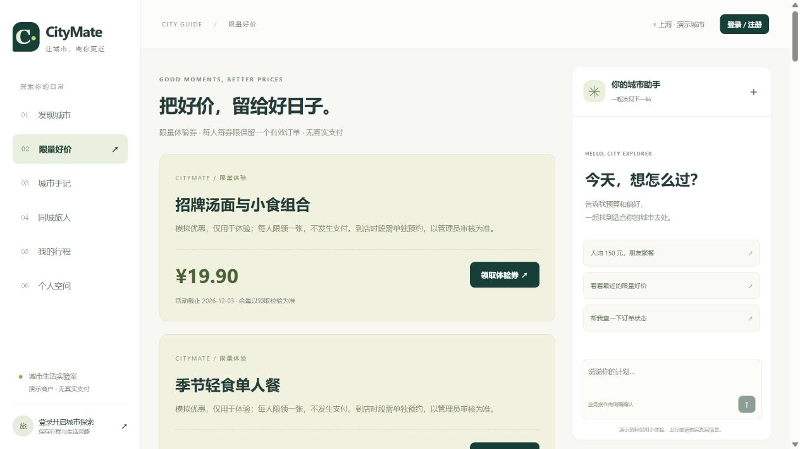

# CityMate · 城市生活助手

将 **Agent 工具调用与 Python 后端业务**结合的本地生活演示项目。用户可以发现商户、领取优惠、查看异步订单、提交预约、发布探店手记，也可以通过 AI 助手完成推荐查询、预约草稿生成和政策问答。

项目重点是让模型调用真实业务工具，并由服务端校验身份、参数、状态和确认操作；同时实现 Redis 缓存、Lua 库存预扣、Streams 消费、数据库事务与 Outbox 补偿，保留自动化测试、真实模型评测和 HTTP 压测证据。



> 所有商户和政策均为虚构演示资料。验证码展示在页面，不发送真实短信；优惠订单不涉及真实支付、退款或核销。本项目尚未通过生产高可用与完整回答质量验收。

## 功能

| 模块 | 已实现能力 |
|---|---|
| 商户发现 | 类别、关键词、人均预算筛选，商户详情，页面端 GEO 附近查询 |
| 登录与权限 | Redis 共享 Session、HttpOnly Cookie、验证码一次消费、登录会话轮换与续期、管理员权限 |
| 限量优惠 | Lua 原子预扣、一人一单、异步生成订单、订单查询与取消补偿 |
| 预约 | 时段查询、15 分钟有效草稿、用户明确确认、管理员审核、事务内扣减名额 |
| 社区 | 图文手记、点赞、关注流、共同关注、签到积分与排行榜 |
| AI 助手 | 多轮偏好、按角色开放工具、政策检索、预约草稿、本人的订单查询、调用轨迹与 Token 用量 |
| 管理与观测 | 商户维护、预约审核、健康检查、消费者心跳、请求指标和近似独立访客统计 |

## Agent 如何工作

助手根据对话选择城市推荐、预约、优惠或订单角色，每个角色只能使用限定工具。角色切换由程序规则实现，模型负责在允许范围内选择工具和生成回答。

| 工具 | 作用 |
|---|---|
| `search_shops` / `shop_details` | 查询项目内商户、类别与预算条件 |
| `available_slots` / `prepare_appointment` | 查询真实时段并生成预约草稿 |
| `vouchers` / `my_orders` | 查询优惠及当前登录用户的订单 |
| `knowledge_search` | 检索演示政策并返回来源 |

- **业务身份由服务端确定：** 工具不允许模型覆盖当前用户身份；参数由 Pydantic 校验。
- **写操作需要确认：** 模型只能生成预约草稿；用户点击确认或输入完整口令后，程序提交待审核申请。确认不代表商户已经批准。
- **关键业务回执由程序生成：** 预约草稿和订单查询成功后，直接依据工具结果输出，避免模型自行编造编号与状态。
- **会话保存在 Redis：** 保存历史、角色和明确偏好，通过会话锁约束同一用户会话的并发修改。
- **检索支持溯源：** 政策按标题和段落分块，长段落使用字符窗口与重叠；结果包含来源、章节、版本及原文位置。默认是本地词项检索，Chroma 向量检索和 MCP stdio 服务为可选路径。
- **前端渲染 Markdown：** 支持标题、表格、列表和代码块，转义原始 HTML、过滤危险链接，不自动加载模型输出的远程图片。

示例对话：

```text
推荐人均不超过 100 元的美食餐厅
改成咖啡店，人均不超过 50 元
我想预约青岚攀岩，请查询可预约时段
请选择返回的某个时段，2 个人，生成预约草稿
预约草稿的有效期是多久？请查询平台政策
```

当前真实模型评测使用云端 `Qwen/Qwen3-32B`，没有在本机部署 32B 权重；模型通过兼容 OpenAI 的 API 接入。未配置模型时使用明确标注的规则助手。**页面端支持附近查询，但当前对话工具不支持坐标或距离筛选**；助手也不能替用户抢券、取消订单、付款或批准预约。

## 后端设计

- **缓存：** 空值缓存、互斥重建、写后失效；另有可选逻辑过期分支，其验证范围见讲义。
- **分布式锁：** 使用 redis-py 的所有权令牌锁；没有实现 Java Redisson 的自动看门狗机制。
- **抢购与订单：** Lua 同步完成活动时间、库存和重复领取校验，预扣后入队；HTTP 202 仅表示受理，最终结果由独立消费者生成。
- **一致性与恢复：** SQL 事务、唯一购买约束和条件更新防止重复成单；Streams 消费组支持 ACK、pending 重试及接管；订单与 Outbox 同事务提交，事件幂等投递并补偿库存。
- **Redis 数据结构：** Hash 会话、GEO 商户位置、Bitmap 签到、Set 关注、ZSet 点赞/动态/排行、HyperLogLog 访客和 Streams 消息。

这些机制及故障用例展示了业务一致性处理，不能推导为 Redis 整体数据丢失等灾难情况下零丢单。

## 技术栈

| 层次 | 技术 |
|---|---|
| 前端 | Vue 3、Vite、markdown-it |
| API 与数据 | Python 3.12、FastAPI、Pydantic、SQLAlchemy、Alembic、MySQL |
| 缓存与异步 | Redis、redis-py、Lua、Redis Streams、独立 Python Worker |
| Agent | 兼容 OpenAI API 的工具调用、角色工具白名单、Redis 会话、业务确认与回执模板 |
| 可选检索 | Chroma、MCP SDK、政策分块及来源元数据 |
| 工程与验证 | Docker Compose、Nginx、pytest、fakeredis、HTTPX、Black、Prettier、Prometheus 指标 |

## 快速启动

需要 Docker 与 Docker Compose，在仓库根目录运行：

```bash
docker compose -p citymate up -d --build
```

默认使用 MySQL 8.4、Redis 7.4，初始化服务负责迁移和导入基础演示数据，API 与 Worker 分开运行。

| 入口 | 地址 |
|---|---|
| 前端 | <http://localhost:15173> |
| API 文档 | <http://localhost:18000/docs> |
| 健康检查 | <http://localhost:18000/health> |

演示管理员手机号为 `13900000000`；其他格式正确的手机号首次登录自动注册普通用户。获取验证码后在页面直接查看并登录。

如需使用真实模型，复制根目录 `.env.example` 为 `.env`，在本机填写 `OPENAI_API_KEY`、`OPENAI_MODEL` 和 `OPENAI_BASE_URL`，然后重新执行启动命令。`.env` 不进入版本控制；默认示例模型名不代表已经配备可用密钥。Chroma/MCP 需要额外依赖及开关，见 [开发与验收指南](docs/CITYMATE.md)。

本地开发需要 Python 3.12、Node.js 22、MySQL 和 Redis。完成依赖安装及数据库初始化后，Windows 可运行 `./start.ps1` 启动 API、Worker 和前端；`./start.ps1 -EnableModel` 启用已配置的模型，`./start.ps1 -Action stop` 停止该脚本启动的应用进程。详细安装与手动启动步骤见 [开发指南](docs/CITYMATE.md)。

截图使用扩充演示数据。首次部署只有基础数据，可按开发指南运行 `python -m citymate.cli seed-rich` 追加商户、手记及模拟账号。默认配置仅面向本机演示；完整容器配置与本机缓存镜像验证环境不同，不能将 MySQL 5.7 的实测结果直接视为 MySQL 8.4 的性能成绩。

## 运行测试

在 `backend` 目录使用项目 Python 环境：

```bash
python -m pip install -r requirements-dev.txt
python -m pytest -q
python -m black --check citymate tests migrations evals

# 可选：真实模型调用，会产生费用；使用隔离的合成业务数据
python -m evals.run_agent --live --repeat 2 --output logs/agent-new-run.json
```

默认测试使用 SQLite/FakeRedis；真实 MySQL/Redis 用例与 Chroma/MCP 用例需要按报告配置依赖和环境变量，跳过不算验证通过。真实 TCP 压测入口是 `python -m evals.run_load`，必须准备独立空测试库及 Redis DB 15，详见 [复现步骤](docs/压力测试与容量验证报告.md#4-复现)。

在 `frontend` 目录：

```bash
npm ci
npm test
npm run build
npm run format:check
```

## 项目结构

```text
backend/
  citymate/
    app.py / routers/     API、生命周期、业务路由
    dependencies.py       当前用户与权限依赖
    service.py            Session、商户、缓存、GEO
    commerce.py           订单、Outbox、预约事务
    social.py             社区、关注、签到、排行
    assistant.py          角色、工具调用、确认与回执
    knowledge*.py         分块检索及 MCP 客户端/服务端
    policies/             三份演示政策
    worker.py             独立订单消费者
  migrations/             Alembic 数据库迁移
  tests/                  自动化测试
  evals/                  模型、检索与 HTTP 压测入口
frontend/
  src/App.vue             页面入口
  src/components/         助手 Markdown 展示组件
  src/lib/                HTTP 与 Markdown 处理
  tests/                  前端测试
docs/                     项目说明、讲义、报告与原始证据
docker-compose.yml        完整容器部署入口
start.ps1                 Windows 本地启动/停止入口
```

本项目由 CoursePilot 演进而来，现已统一为 CityMate，旧教育版入口不在当前源码中。

## 文档导航

- [项目说明](docs/项目说明.md)：功能、架构、业务流程与实现边界。
- [开发与验收指南](docs/CITYMATE.md)：环境、启动、模型配置与演示路线。
- [Redis 实战项目讲义](docs/CityMate-Redis实战项目讲义.md)：对照源码学习 Redis 与后端设计。
- [代码结构与开发规范](docs/代码结构与开发规范.md)：模块职责、命名与目录约定。
- [Agent 专项评测报告](docs/Agent专项评测报告.md)：固定场景、真实模型、修复与失败样本。
- [知识检索联调报告](docs/知识检索联调报告.md)：分块、Chroma/MCP、检索质量与版本边界。
- [并发与故障验证报告](docs/并发与故障验证报告.md)：真实数据库、消费者中断、重试与补偿。
- [压力测试与容量验证报告](docs/压力测试与容量验证报告.md)：实际并发、延迟、吞吐、队列与完整 Agent 任务。
