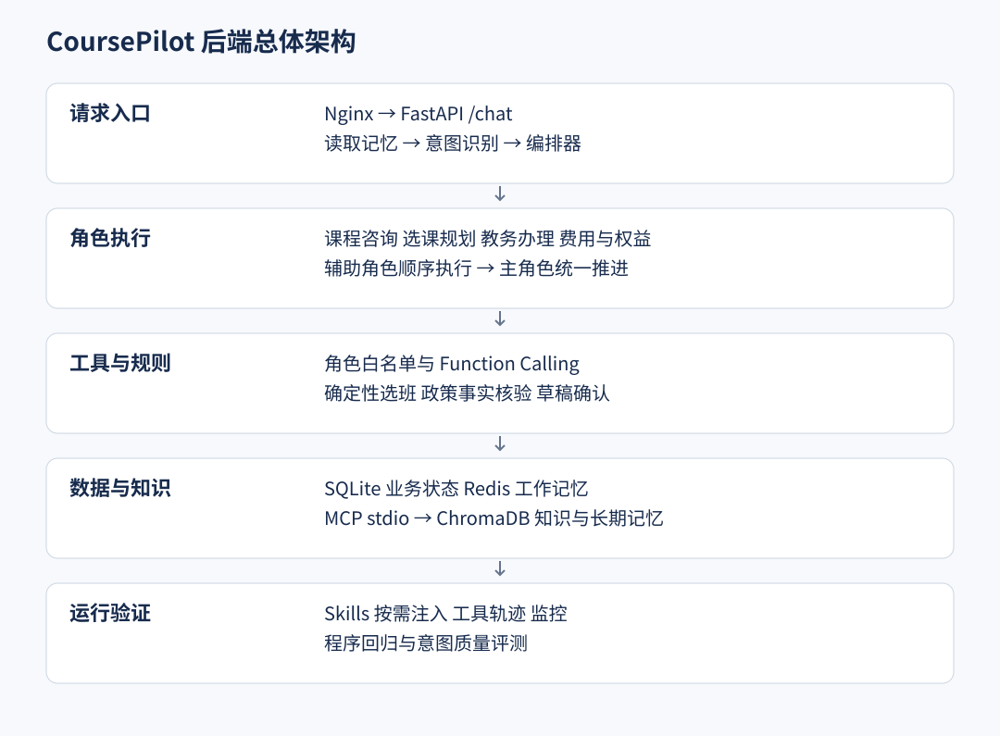
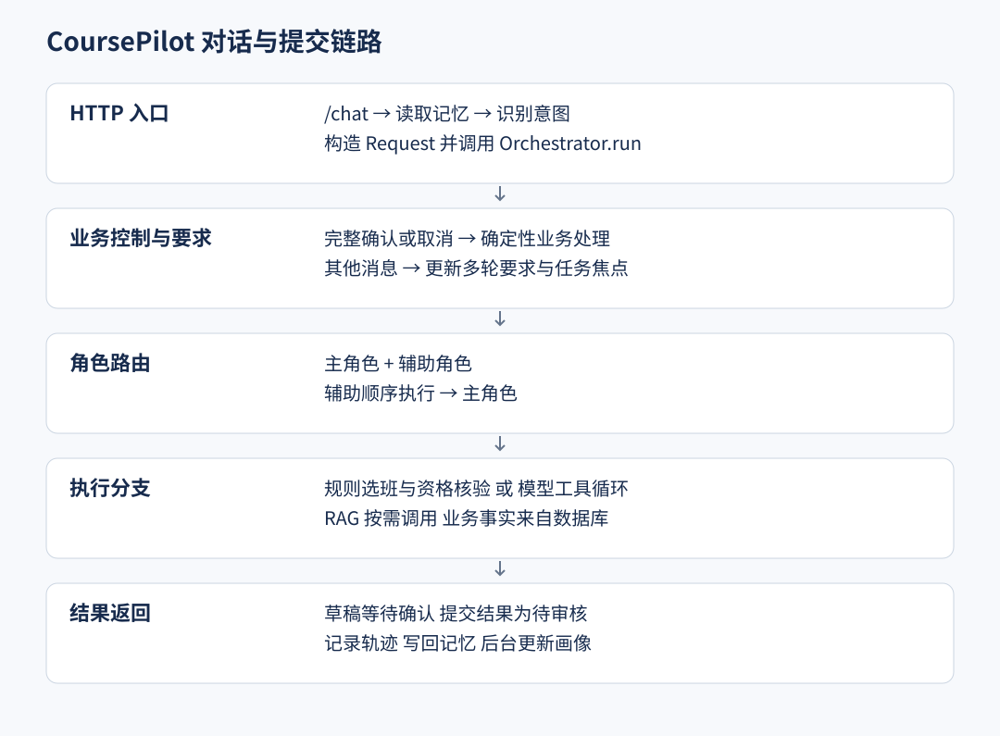
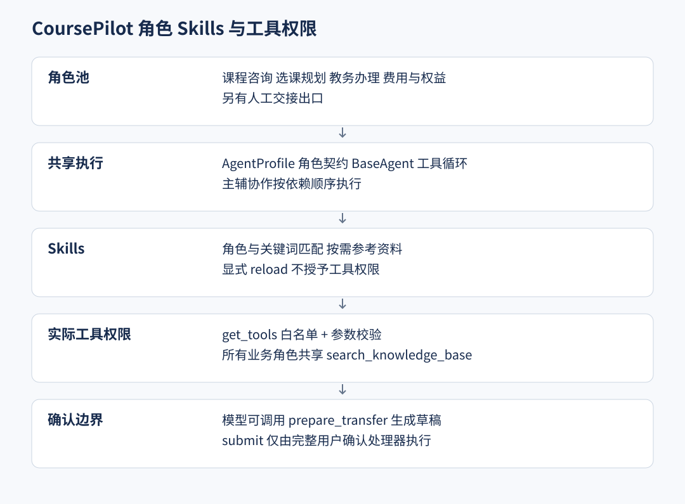
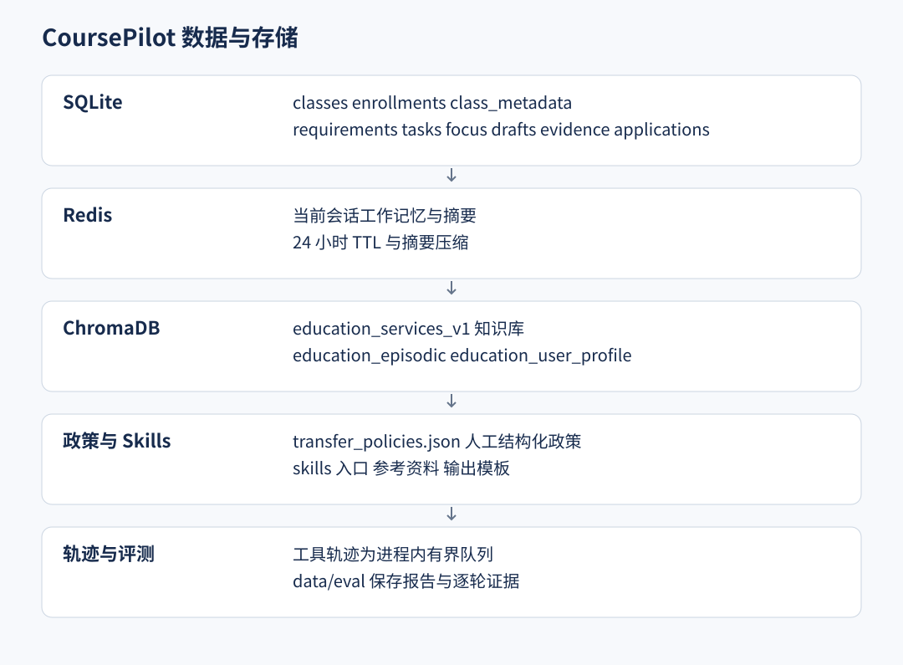
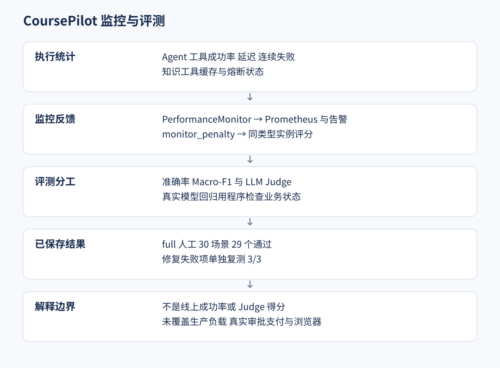
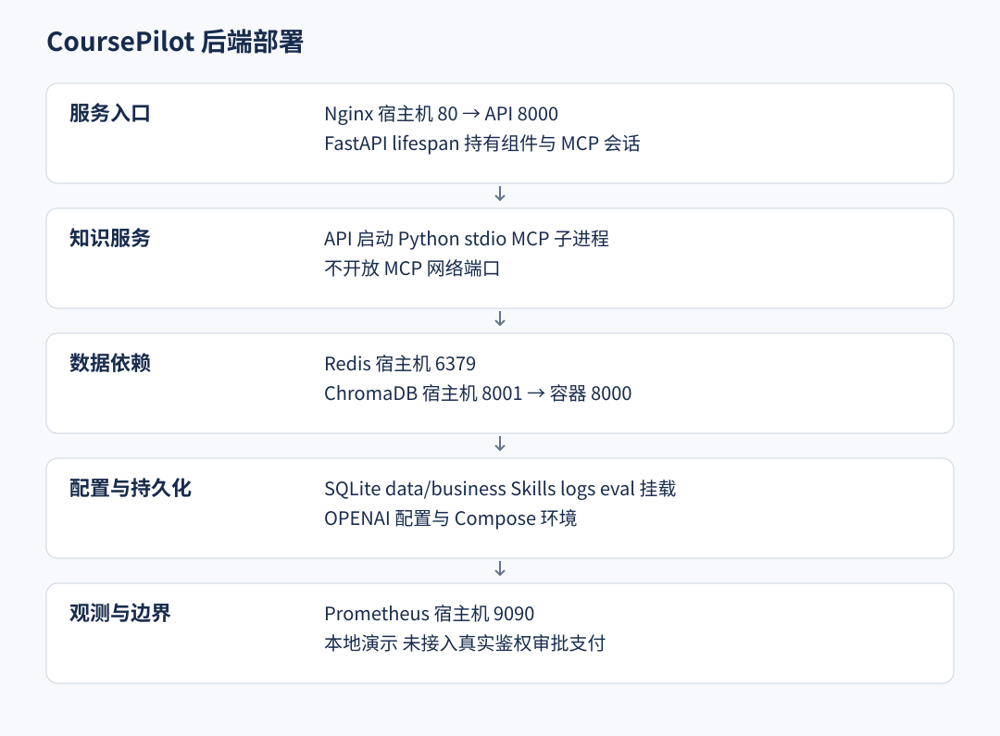

# CoursePilot 后端架构图

六张图对应当前 Python 教务后端，更新时间：2026 年 10 月 7 日。配套源码见[详细学习指南](后端架构与源码学习指南.md)。

## CoursePilot 后端总体架构



请求经 FastAPI 进入编排器，四类角色调用白名单工具；业务状态在 SQLite，知识检索经 MCP，记忆分别位于 Redis 和 ChromaDB。

## CoursePilot 对话与提交链路



HTTP 入口先读取记忆和识别意图。编排器优先处理完整确认，再更新要求和路由；部分业务由规则执行，其他进入模型工具循环。

## CoursePilot 角色 Skills 与工具权限



Skills 影响处理规范，实际权限来自工具白名单。模型可以准备草稿，不能直接提交申请。当前主辅协作顺序执行。

## CoursePilot 数据与存储



当前知识 collection 为 education_services_v1。结构化政策与通用 RAG 并存；轨迹不是持久审计数据库。

## CoursePilot 监控与评测



监控反馈影响同类型实例评分。质量 Judge 与业务程序核验分开解读，29/30 仅为保存的一次人工场景回归。

## CoursePilot 后端部署



Compose 包含 API、Redis、ChromaDB、Prometheus 与 Nginx；stdio 子进程由 API 生命周期管理，不是独立网络服务。

## 主流程文字版

```text
HTTP /chat → 读取记忆 → 意图识别 → 编排器业务控制与要求更新
→ 主角色与辅助角色选择 → 辅助角色顺序执行 → 主角色执行
→ 确定性规则或模型工具循环 → 回复与轨迹 → 写回消息与后台画像

共享 RAG 工具 → 查询改写与并行召回 → MCP stdio → ChromaDB → 重排
业务工具 → SQLite 与结构化政策 → 生成草稿 → 完整确认口令 → 复核提交
```

当前为 Python 教务演示后端。`user_id` 由客户端传入，只有 `student_demo` 有预置报名；没有真实登录、审批、支付或退款连接。提交结果为 `pending_review`，不修改报名、不占名额、不扣款。旧客服、作业辅导角色和 Java 描述不属于当前默认业务实现。
