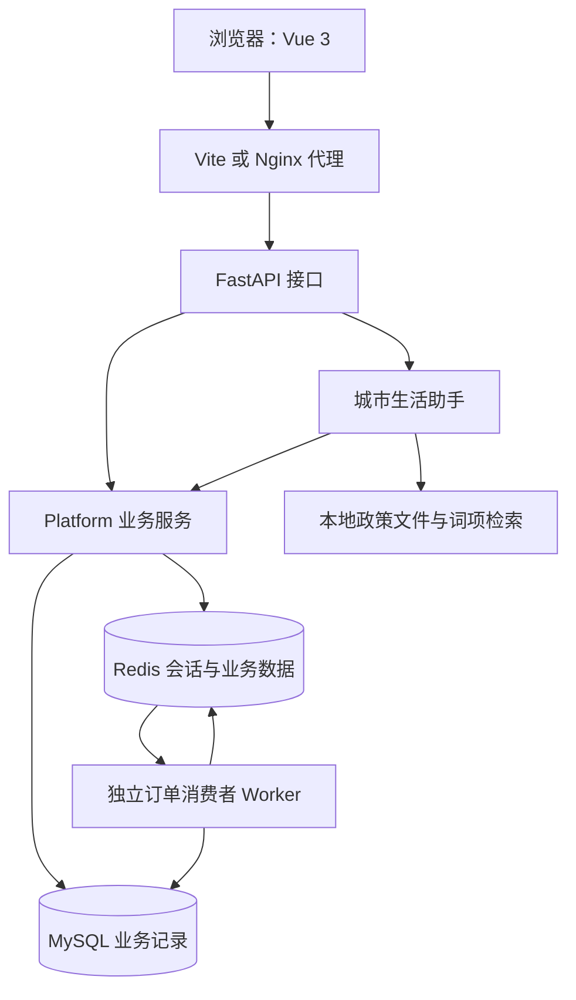
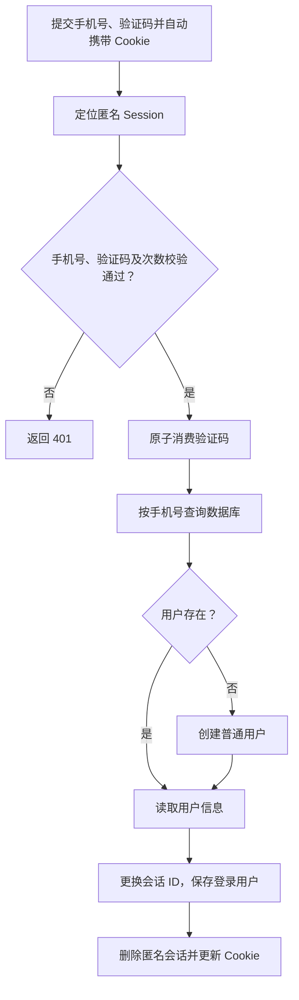
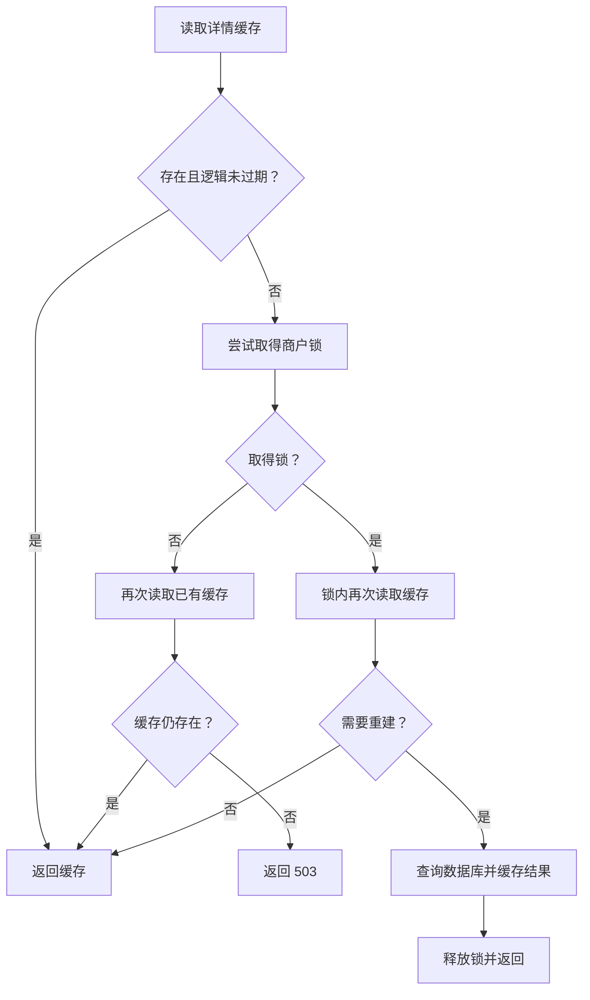
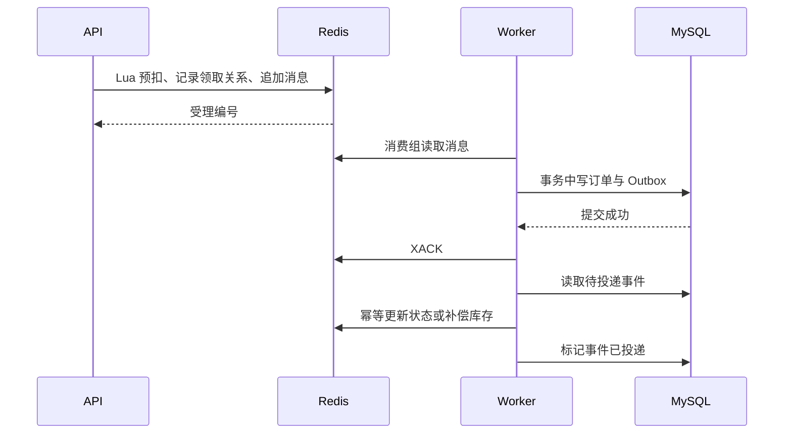
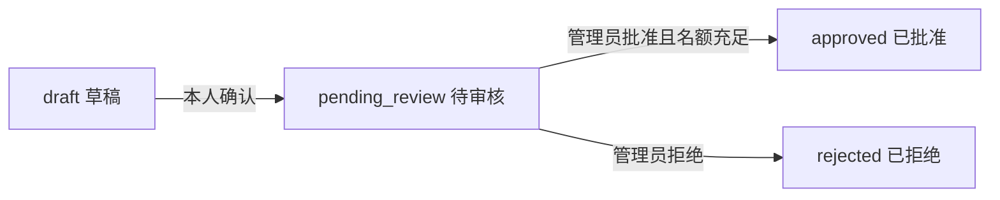

# CityMate 城市生活助手：Redis 实战项目讲义

源码核对日期：2026 年 10 月 20 日。

本文以当前 CityMate 源码为依据，按照“业务需求 → 实现流程 → 代码入口 → 验证依据”介绍项目。正文只讲仓库中有实际代码的能力；没有实现的教程功能集中列在文末边界清单，不能作为本项目成果。

原参考讲义基于 Java 黑马点评，CityMate 使用 Python。本文不再要求章节标题与 Java 教程逐项对应。代码节选省略了所在类、导入和部分异常处理，应结合链接指向的完整文件阅读。“已有代码”“默认启用”“已测试通过”分别标注；文中的手工检查步骤不代表已经做过全部验证。

### 实现与验证依据

下表中的测试文件位于 [backend/tests/](../backend/tests/)；最近一次真实服务运行结果见 [并发与故障验证报告](并发与故障验证报告.md)。表中“已覆盖”只指所列测试条件，不表示该模块所有异常路径均已验证。

| 正文主题 | 实际代码入口 | 已有验证或限制 |
|---|---|---|
| 验证码、Session、权限 | [service.py](../backend/citymate/service.py) 的 `code/login/authenticate`；[dependencies.py](../backend/citymate/dependencies.py) | `test_sessions.py`、`test_platform.py`；实际短信未接入 |
| 详情缓存、空结果、修改后失效 | `Core.shop/_rebuild_shop/edit_shop` | `test_platform.py::test_negative_cache_and_invalidation` |
| 逻辑过期与后台刷新 | `Core.shop` 的 `logical` 分支 | 已有代码、默认关闭；尚无该分支专项自动化验证 |
| Redis 锁与 SQL 约束 | [commerce.py](../backend/citymate/commerce.py)、[models.py](../backend/citymate/models.py) | 并发领取、消费与取消已覆盖；锁租期耗尽场景未覆盖 |
| Lua 受理、Streams、Outbox | [scripts.py](../backend/citymate/scripts.py)、[worker.py](../backend/citymate/worker.py) | `test_platform.py`、`test_real_reliability.py` |
| 手记、图片、点赞、关注、Feed | [social.py](../backend/citymate/social.py)、[community.py](../backend/citymate/routers/community.py) | 上传校验、重复点赞、关注与同分分页已覆盖 |
| GEO 与 UV | `Core.shops/shop`、[system.py](../backend/citymate/routers/system.py) | `test_geo_and_uv_dedup`；没有全国商户数据 |
| 签到与排行 | `Social.checkin/checkin_stats/ranking` | 重复签到、位图丢失后重建已覆盖；跨月算法已读源码，未做专项测试 |
| 预约 | `Commerce.draft_appointment/confirm_appointment/review` | 身份校验、容量与并发审批已覆盖 |
| 规则/模型助手与记忆 | [assistant.py](../backend/citymate/assistant.py) | 程序回归与 36 场景真实模型评测分别记录，见 [Agent 专项评测报告](Agent专项评测报告.md) |
| 本地政策检索 | [knowledge.py](../backend/citymate/knowledge.py) 的词项分支 | 实际模型工具调用记录见 [开发指南](CITYMATE.md)；不是向量检索 |
| Markdown 展示 | [MarkdownMessage.vue](../frontend/src/components/MarkdownMessage.vue)、[markdown.js](../frontend/src/lib/markdown.js) | [markdown.test.js](../frontend/tests/markdown.test.js) 与实际浏览器验证 |

Chroma、MCP 已于 2026-10-21 完成隔离环境全链路联调，仍为默认关闭的可选能力。中文检索排序与回答准确性尚有限制，单独记录在文末及 [知识检索联调报告](知识检索联调报告.md)，不等同于生产级检索验收。

## 开篇导读

### 项目解决什么问题

CityMate 是一个本地生活演示平台。用户可以查找附近商户、领取限量优惠、预约到店、发布探店手记、关注作者和签到；管理员维护商户与优惠，审核预约；智能助手帮助用户查询商户、政策和本人订单，并辅助生成预约草稿。

本项目的学习重点是：一个普通业务请求在遇到并发、重复请求、缓存过期、后台进程退出时，如何继续保持合理的业务结果。

例如，“领取优惠”不是简单地把库存减一，还要处理同一用户重复点击、多个用户同时抢最后一张券、数据库写入失败、消息重复消费，以及取消订单后的库存返还。

### 当前使用的技术

本文对应统一后的 CityMate 项目，仓库目录暂仍叫 `CoursePilot-GitHub`。旧教育版入口已从当前源码移出；目录变化见 [代码结构与开发规范](代码结构与开发规范.md)。

| 技术 | 本项目实现位置或用途 |
|---|---|
| FastAPI | HTTP 路由、请求依赖、异常响应 |
| Pydantic | 手机号、验证码及业务参数模型 |
| Python 业务类 | Core、Commerce、Social，以及组合后的 Platform |
| SQLAlchemy | ORM、条件更新与 `with self.db.begin()` 事务 |
| Redis 共享 Session | Cookie 标识会话，Redis Hash 保存状态 |
| 请求级用户上下文 | `Depends(current_user)`、`request.state.user` |
| redis-py | Redis 命令、Lua 调用与带所有权令牌的锁 |
| Redis Streams 消费者 | 独立运行的 Python Worker |

### 架构与职责



前端请求 `/api/shops`，代理去掉 `/api` 后转到后端 `/shops`。接口返回结果由前端展示；异步订单另外交给 Worker 处理。

MySQL 保存可追溯的业务记录。Redis 用于会话、热点查询、原子受理、消息队列和集合计算。抢购预扣、待消费消息等数据具有业务意义，不能与普通详情缓存一起随意清空。

主要入口：

| 文件 | 作用 |
|---|---|
| [app.py](../backend/citymate/app.py) | 应用工厂、生命周期、中间件、注册路由 |
| [schemas.py](../backend/citymate/schemas.py) | 请求参数与字段校验 |
| [dependencies.py](../backend/citymate/dependencies.py) | 当前用户、管理员、服务依赖 |
| [routers/](../backend/citymate/routers/) | 六类业务接口、图片上传和系统指标 |
| [runtime.py](../backend/citymate/runtime.py) | 组合业务服务并连接数据库、Redis |
| [service.py](../backend/citymate/service.py) | 登录、商户、缓存、GEO、UV、基础初始化 |
| [commerce.py](../backend/citymate/commerce.py) | 库存、订单、Outbox、预约 |
| [scripts.py](../backend/citymate/scripts.py) | 验证码、抢购受理、订单补偿的 Lua 脚本 |
| [worker.py](../backend/citymate/worker.py) | 消费组、确认、重试、接管和心跳 |
| [social.py](../backend/citymate/social.py) | 手记、点赞、关注、动态、签到、排行 |
| [assistant.py](../backend/citymate/assistant.py) | 规则或模型模式、工具权限、会话记忆 |
| [models.py](../backend/citymate/models.py) | 数据表、主键与唯一约束 |
| [App.vue](../frontend/src/App.vue) | 当前页面及请求、登录、交互逻辑 |
| [MarkdownMessage.vue](../frontend/src/components/MarkdownMessage.vue) | 助手回复的独立渲染组件 |
| [markdown.js](../frontend/src/lib/markdown.js) | Markdown 解析、链接及图片显示规则 |
| [styles.css](../frontend/src/styles.css) | 响应式布局、聊天排版与表格滚动 |

## 1、验证码登录与共享 Session

### 1.1 业务需求

用户输入手机号获取验证码，再提交手机号和验证码登录。手机号尚未注册时，系统自动创建普通用户；登录后，查询本人订单等接口必须知道“这次请求是谁发起的”。

当前采用 **Session + Cookie** 交互方式，Session 存在 Redis 中，不放在单个 API 进程内存里；多个实例连接相同 Redis 和前缀时可读取同一会话。当前验证不包含多 API 实例部署。前端通过 Cookie 携带会话 ID。

Session 是服务端保存会话状态的机制，不要求状态一定存在某个应用进程的内存里。Cookie 只携带随机会话 ID，用户信息和验证码保存在服务端。

### 1.2 获取验证码

1. `POST /auth/code` 接收手机号，Pydantic 校验格式。
2. 对来源 IP 限制获取频率：一个 600 秒窗口最多受理 20 次。
3. 对手机号设置 60 秒获取间隔。
4. 生成六位随机验证码和匿名会话 ID。
5. 将手机号和验证码写入该会话的 Redis Hash，设置 300 秒有效期。
6. 通过 `Set-Cookie` 返回 `citymate_session`；演示验证码直接返回页面。

核心节选，见 `Core.code()`：

```python
code = f'{secrets.randbelow(1000000):06d}'
session_id = secrets.token_urlsafe(32)
key = self.session_key(session_id)
with self.r.pipeline() as pipe:
    pipe.hset(key, mapping={'phone': phone, 'code': code})
    pipe.expire(key, 300)
    pipe.execute()
```

会话 Key 的形式为：

```text
citymate:{citymate}:http-session:<SHA-256(会话ID)>
```

匿名会话中的 `phone`、`code` 用于校验；`attempts` 在尝试登录时累加。手机号并不是这个会话 Key 的组成部分，但仍存在服务端的会话字段及手机号限流 Key 中。

**当前没有真实发送短信。** 开启 `CITYMATE_DEMO` 时显示演示验证码；关闭后，接口明确返回短信服务尚未配置。

### 1.3 登录与自动注册



`VERIFY_CODE` 用 Lua 一次完成“检查 → 比较 → 删除验证码字段”。如果校验和删除分为两次独立请求，并发登录可能在删除前都读到同一个有效验证码。

每个匿名会话最多允许五次验证码校验；成功后验证码不能再使用。验证码绑定获取它的会话，因此只拿到数字、却没有相应 Cookie 的另一个浏览器不能直接登录。

数据库以手机号唯一约束防止并发注册创建重复用户。登录成功后生成新的会话 ID，将用户对象序列化到 Hash 的 `user` 字段，并删除旧匿名会话，降低固定旧会话 ID 带来的风险。

### 1.4 校验登录状态与续期

受保护接口声明 `user=Depends(current_user)`，实现位于 `dependencies.py`：

```python
def current_user(request: Request, platform=Depends(get_platform)):
    request.state.user = platform.authenticate(
        request.cookies.get(platform.cfg.session_cookie)
    )
    return request.state.user
```

`authenticate()` 查找 Redis Session 的 `user` 字段；缺失时返回 401。存在时把 Session 有效期续为 1800 秒，并根据用户 ID 重新读取数据库中的用户信息，保证角色修改能在后续鉴权时生效。

当前用户通过请求对象及依赖注入传递，不保存到全局变量。异步请求可能交错运行，因此项目采用请求级状态保存身份。

当前只有执行鉴权的请求会续期，访问公开分类或商户列表不会续期。

### 1.5 前端、退出与安全边界

Cookie 使用 `HttpOnly`、`SameSite=Lax`、`Path=/`。HTTPS 部署可设置 `CITYMATE_COOKIE_SECURE=true`。前端用同源请求自动携带 Cookie，刷新后通过 `/me` 恢复用户，不在 localStorage 保存登录凭证。

写请求需要 `X-CityMate-Request: 1`，配合未开放跨域 CORS 的同源访问方式限制伪造写请求。退出时删除 Redis 会话，并让浏览器清除 Cookie。

公开用户资料会移除手机号和角色；本人资料与权限判断使用服务端读取的信息。普通注册请求不能自行提交管理员角色。

**验证方法：** 登录后刷新页面，检查仍能读取本人资料；退出后再次访问 `/me` 应为 401；把验证码放到另一个无 Cookie 的客户端应登录失败。自动化覆盖见 [test_sessions.py](../backend/tests/test_sessions.py)。

## 2、商户查询缓存

### 2.1 为什么缓存商户详情

商户介绍、地址和营业时间通常读多写少。详情每次查库会重复读取相同信息，适合先查 Redis，未命中再查数据库。

当前缓存对象是**商户详情**；分类查询和普通商户列表仍直接访问数据库，不能把整个商户模块说成都由缓存返回。

### 2.2 缓存结构与两种时间

`shop:<商户ID>` 保存 JSON：

```json
{"data": {"id": "s1", "name": "梧桐小馆"}, "until": 1800000000}
```

以上为结构示意，`until` 示例值表示逻辑过期时间戳，实际 `data` 包含完整商户字段。

| 数据 | 逻辑有效期 | Redis Key TTL |
|---|---|---|
| 存在的商户 | 300 秒 | 3600 秒 |
| 不存在的商户，`data=null` | 30 秒 | 30 秒 |

逻辑时间决定内容是否新鲜；Redis TTL 决定这份内容还能在 Redis 保留多久。两者不同，才有条件在内容过期后暂时返回旧数据。

### 2.3 缓存穿透：缓存空结果

访问不存在的商户时，数据库也查不到。如果完全不缓存这个结果，同一无效 ID 会反复查询数据库。

当前将 `data=null` 缓存 30 秒。在这段时间内再次请求该 ID，直接得到不存在的结果并返回 404。短 TTL 减少后来新建相同 ID 时受到旧空结果影响的时间。

这项实现处理的是同一无效商户 ID 的重复查询；不同无效 ID 的大量请求仍可能访问数据库。

### 2.4 缓存击穿：互斥重建

默认 `CITYMATE_CACHE_MODE=mutex`。缓存失效时，`_rebuild_shop()` 取得 `lock:shop:<ID>`，在锁内再检查一次缓存，再决定是否查库。

锁内第二次检查很有必要：等待锁的过程中，另一个请求可能已经完成重建。



代码为锁设置 15 秒租期、最多 2 秒获取等待。拿不到锁时会再次尝试读已有缓存，即使它已逻辑过期；完全没有缓存则返回 503。图中的返回缓存或重建结果，若 `data=null`，接口实际返回 404。因此这不是所有请求无限等待到最新值的方案，也不能描述成严格强一致读取。

### 2.5 逻辑过期：已有代码，需显式启用

设置 `CITYMATE_CACHE_MODE=logical` 后，若缓存仍存在但逻辑过期，当前请求先返回旧值，再安排后台重建。

`refresh:<ID>` 通过 `SET NX EX 20` 限制重复排队；两个线程组成的后台线程池执行重建，实际重建仍使用商户锁。若缓存已经被 Redis 删除，则仍需走首次加载路径。

该分支允许暂时返回旧商户资料；默认配置使用 `mutex`，当前没有逻辑过期分支的专项测试，不能据此声称已验证其性能或极端并发行为。

### 2.6 修改商户后如何更新缓存

`edit_shop()` 使用同一商户锁，在数据库事务提交后删除详情缓存，再更新 GEO 坐标，随后读取详情触发重建。

它遵循“先更新数据库，再使缓存失效”的思路。数据库和 Redis 不是一个事务：如果数据库提交后 Redis 操作失败，仍可能暂时保留旧缓存。当前商户更新没有使用 Outbox 自动补偿，应按实际边界介绍。

### 2.7 依赖异常与验证范围

`app.py` 为冒泡到接口层的 `RedisError` 和 `SQLAlchemyError` 注册异常处理器，记录日志并返回 503。它用于告知请求方数据服务暂不可用；后台线程异常不因此自动重试，模型工具内部捕获的异常也可能作为工具错误返回。

**验证方法：** 连续查询不存在的商户，确认空结果 Key 存在；修改商户后重新查询，确认信息更新。现有测试覆盖空缓存和修改失效；逻辑过期与极端并发还需专项验证。

## 3、限量优惠与防超卖

### 3.1 业务需求

每张优惠券有活动开始时间、结束时间、价格和库存。用户领取时，系统需要限制超量受理，避免同一用户重复占用名额，并最终生成本人可查询的订单。

当前“领取优惠”只产生演示订单，没有真实付款、退款或核销。

### 3.2 全局订单 ID

`Core.identifier()` 将时间与 Redis 日序列组合：

```python
seq = self.r.incr(key)
return str(((now - 1640995200) << 32) | seq)
```

高位表示相对 2022-01-01 UTC 的秒数，低 32 位放日内递增序列。日序列首次创建时设置 172800 秒 TTL；超过 32 位范围时拒绝生成。

多实例共享同一 Redis 计数器时可以协调编号；返回字符串避免浏览器大整数精度损失。该实现依赖时钟和计数器状态，未提供时钟回拨或 Redis 数据丢失时的全面容错保证。

用户与预约等对象还使用 UUID，并非所有表都用这个 ID 算法。

### 3.3 为什么先查询库存再减一不够

假设只剩一张券，两个请求都查询到库存为 1，然后分别创建订单。如果判断和扣减没有并发控制，就可能卖出两张。

本项目分别在两个阶段控制：

| 阶段 | 控制方法 |
|---|---|
| Redis 受理 | Lua 内检查库存、扣减库存、记录用户、追加消息 |
| SQL 成单 | 事务中锁定优惠记录，再用 `stock > 0` 条件扣减 |
| 重复处理 | 订单主键与有效购买键唯一约束，加上处理前检查 |

数据库条件扣减的核心为：

```python
db.execute(
    update(Voucher)
    .where(Voucher.id == voucher_id, Voucher.stock > 0)
    .values(stock=Voucher.stock - 1)
).rowcount == 1
```

项目采用条件更新并结合行锁，不是教程里另建 `version` 字段的版本号方案。

### 3.4 一人一单与重复点击

Redis 的 `buyers:<券ID>` 是 Hash，保存 `用户ID → 订单ID`。同一用户再次领取，会返回已有编号，不重复预扣。

数据库 `purchase_key` 保存 `用户ID:券ID`，并设置唯一约束。成功取消后清除有效购买键，待 Redis 补偿释放领取记录后可以重新领取。

所以准确的规则是“同一用户对同一优惠同时只保留一个有效领取记录”，而不是“历史上永远只能领取一次”。

**验证方法：** 测试用 25 个用户并发争抢 10 个名额，断言只受理 10 个不同订单；重复提交同一用户请求，确认返回原订单 ID。该测试不是生产吞吐量压测。

## 4、分布式锁

### 4.1 为什么进程内锁不够

同一个业务部署多个 API 进程后，各进程的本地锁互不共享。需要跨进程协调的操作使用 Redis 锁，例如同一商户缓存重建、同一笔记点赞关系更新。

### 4.2 本项目如何使用锁

典型写法：

```python
with self.r.lock(
    self.key('lock:like:' + note_id),
    timeout=10,
    blocking_timeout=3,
):
    # 写入数据库，再同步 Redis 派生数据。
    ...
```

| 锁对象 | 主要用途 |
|---|---|
| `lock:shop:<ID>` | 协调详情重建与商户修改 |
| `lock:stock:<券ID>` | 避免库存首次初始化相互覆盖 |
| `lock:like:<笔记ID>` | 串行化该笔记的点赞写入与集合重建 |
| `lock:follow:<用户ID>` | 协调关注关系变更与动态重建 |
| `lock:checkin:<用户ID>` | 协调同一用户签到 |
| `lock:ranking` | 协调积分排行同步与查询 |
| `lock:chat:<用户ID>:<会话ID>` | 避免同一助手会话同时处理多条消息 |

redis-py 的锁使用所有权令牌，释放时核对是否仍是自己持有的锁，避免直接 `DEL` 误删其他请求新获得的锁。业务代码调用库提供的锁方法，而不是自己重复实现锁脚本。

### 4.3 锁的租期不等于业务事务

`timeout` 是持有租期，`blocking_timeout` 是获取锁时的等待上限。业务超过租期后，其他请求可能获得锁；本项目没有自动延长这些锁的租期。

因此数据库唯一约束、条件更新和事务仍然必要。分布式锁不能代替数据库约束，也不能把 MySQL 与 Redis 的多个操作变成一个跨系统事务。

## 5、锁、数据库约束与幂等检查如何配合

项目没有只依靠 Redis 锁保护所有写入。不同业务使用不同约束，实际定义见 `models.py` 和 `commerce.py`：

| 写入场景 | 已实现的控制 |
|---|---|
| 同手机号注册 | `User.phone` 唯一约束；捕获并发插入冲突后查询已有用户 |
| 订单重复消费 | 事务中先锁优惠记录，再按订单主键检查；`purchase_key` 唯一约束限制有效购买 |
| 订单扣库存 | `Voucher.stock > 0` 条件更新，检查影响行数 |
| 同一订单重复取消 | 锁订单行；已取消时直接返回，不再次增加 SQL 库存 |
| 点赞、关注、签到 | 对应 Redis 锁内处理，SQL 联合主键限制重复关系 |
| 预约审批 | 锁预约行，并按 `Slot.seats >= party_size` 条件扣减 |

Redis 锁有固定租期，SQL 唯一约束和事务处理的是持久化记录。上述组合并不构成 MySQL 与 Redis 的统一事务。并发消费、取消和预约容量的实际验证见 `test_real_reliability.py`；锁过期竞争尚未验证。

## 6、秒杀优化：先受理，后成单

### 6.1 为什么引入异步处理

让用户请求等待所有数据库写入完成，会增加请求处理时间。当前实现先在 Redis 原子判断资格并写入任务，再由 Worker 写库。

接口仍会读取数据库中的优惠活动信息，不能宣称整个受理过程完全没有数据库访问；异步化主要拆出了订单写入阶段。

### 6.2 Lua 受理流程

`RESERVE` 依次执行：

1. 检查用户是否已有领取记录，有则返回原编号。
2. 检查库存 Key 是否存在、库存是否大于零。
3. 使用 Redis `TIME` 检查活动窗口。
4. `DECR` 扣减受理库存。
5. 记录领取关系和 `processing` 订单状态。
6. `XADD` 将订单消息加入 Stream。

```lua
redis.call('DECR', KEYS[1])
redis.call('HSET', KEYS[2], ARGV[1], ARGV[2])
redis.call('HSET', KEYS[3], 'status', 'processing',
           'user_id', ARGV[1], 'voucher_id', ARGV[3])
redis.call('XADD', KEYS[4], '*', 'order_id', ARGV[2],
           'user_id', ARGV[1], 'voucher_id', ARGV[3])
```

以上操作在一个脚本中执行，避免正常并发下出现“名额已预扣，但应用进程还没来得及单独发消息就退出”的窗口。Lua 的原子执行不等同于数据库事务回滚，也不等于 Redis 故障时数据不会丢失。

涉及的 Key 统一带 `{citymate}` 哈希标签，有利于多 Key 脚本满足同槽要求；当前配置使用单 Redis 实例，这不代表已经部署或验证 Redis Cluster 的负载分片。

### 6.3 受理成功不等于订单成功

接口返回 HTTP 202 和订单 ID。页面显示“处理中”，然后查询最终结果：

```text
processing → ready → cancelled
           ↘ rejected
```

`ready` 表示演示订单已落库；`rejected` 表示数据库最终校验未通过。前端轮询本人订单状态，不能把 202 直接显示为支付成功。

### 6.4 为什么库存 Key 丢失时不直接重建

MySQL 的库存尚未扣除那些“Redis 已受理、Worker 尚未处理”的请求。若直接拿数据库库存覆盖 Redis，就可能重新释放已被预占的名额。

`initialize_stock()` 发现 `stock:<券ID>` 缺失后取得初始化锁，再检查：SQL 是否已有该券订单、Redis 是否还有 `buyers:<券ID>` 或 `initialized:<券ID>`。只要任一证据存在，就返回 503。三者都不存在时，代码会按 SQL 库存初始化计数器。

这项保护依赖证据仍然存在。如果尚未落库的预扣、消息与 Redis 标记一起丢失，SQL 又没有历史订单，当前检查无法识别此前的预扣；它不提供 Redis 整体丢失后的安全自动恢复保证。

## 7、Redis 消息队列与可靠处理

### 7.1 当前采用哪种消息机制

本项目的异步订单采用 **Streams 消费者组**，实现位于 `Worker`。

| 项目 | 配置或行为 |
|---|---|
| Stream | `orders`，带统一业务前缀 |
| 消费组 | `order-workers` |
| 消息字段 | `order_id`、`user_id`、`voucher_id` |
| 新消息读取 | `XREADGROUP`，读取位置 `>` |
| 当前消费者未完成记录 | 从 `0` 读取 pending |
| 退出消费者的记录接管 | `XAUTOCLAIM`，默认空闲阈值 30 秒 |
| 成功确认 | `XACK` |
| 格式错误消息 | 写入 `dead-orders` 后确认原消息 |

这里的“格式错误”具体指字段集合不是 `order_id`、`user_id`、`voucher_id` 三个字段。字段齐全但内容无效、导致业务处理失败的消息仍会留在 pending，不会自动进入 `dead-orders`。

### 7.2 数据库提交与消息确认



如果数据库提交后、`XACK` 前 Worker 退出，该消息会再次处理。`process_order()` 先锁定优惠记录，再检查订单 ID，已存在则不重复扣库存、创建订单。

因此系统按“至少一次处理机会 + 业务幂等”设计，而不是承诺消息只会交付一次。

### 7.3 Outbox：避免提交业务后遗忘同步事件

直接“提交 SQL，再通知 Redis”存在中断窗口。Outbox 将“订单变更”和“需要同步的事件”写进同一个数据库事务。

只要事务提交，待投递记录也一起存在。`dispatch()` 找到 `done=0` 的事件，调用 Redis 脚本处理，成功后标为完成。Redis 操作失败时，未完成事件可以再次投递。

Outbox 没有消除两个系统之间的时间差；它提供的是可追踪、可重试的同步过程。

### 7.4 取消与补偿为什么不会重复加库存

取消 `ready` 订单时，数据库事务将订单改成 `cancelled`、清除有效购买键、增加 SQL 库存并写 Outbox。

Redis 的 `ORDER_EVENT` 通过 `event:<事件ID>` 防止同一事件重复生效；还核对 `buyers` 中的订单 ID 是否属于正在补偿的订单。只有匹配时才释放领取关系并恢复库存，避免旧订单的延迟事件释放新订单的名额。

迟到的 `ready` 事件不能把 Redis 中已经 `cancelled` 或 `rejected` 的状态改回成功。

### 7.5 故障处理的实际范围

| 情况 | 当前行为 |
|---|---|
| Worker 未运行 | 请求可能停留在 `processing`，需启动消费者 |
| 处理业务异常 | 留在 pending，后续重试 |
| 消费者退出 | 由其他消费者接管空闲未确认消息 |
| 重复消息 | 检查订单与约束，避免重复成单 |
| 数据库拒单 | 写拒绝订单和事件，后续补偿 Redis |
| Redis 更新事件后、SQL 标记前中断 | 事件重投，通过 Redis 标记幂等 |

`XACK` 只确认消息，不自动删除 Stream 记录。当前没有完整的消息裁剪、已完成 Outbox 清理及毒性业务消息重试上限机制，数据规模增大后需要补充。

**验证方法：** 现有测试覆盖重复消费、pending 接管、数据库拒单补偿、重复取消和取消后重领。读代码顺序建议为 `claim()` → `RESERVE` → `Worker.tick()` → `process_order()` → `dispatch()` → `ORDER_EVENT`。

## 8、达人探店：手记、图片与点赞

### 8.1 发布手记

用户提交标题、正文、可选商户和图片路径。服务端验证商户及图片路径，随后在同一 SQL 事务中保存笔记与 `note` 类型 Outbox 事件。

手记内容存入 `cm_notes`；动态投递稍后由 Worker 调用 `deliver_note()` 完成，不要求发布请求同步给所有粉丝写入收件箱。

### 8.2 图片上传

图片先通过 `/uploads` 上传。后端检查内容可解码，支持 JPEG、PNG、WebP；限制单张 5 MB、2000 万像素，缩放到不超过 1600×1600，并重新编码为 JPEG。

笔记最多引用六张已经通过上传接口保存的图片，不能提交任意文件路径。当前图片保存在本地目录，不是对象存储/CDN 方案。

### 8.3 点赞为什么不能只做计数加一

只保存点赞数，无法知道某个用户是否已经点赞，也无法可靠处理重复点击和取消。

数据库以 `(user_id, note_id)` 联合主键记录点赞关系。接口传递期望状态 `enabled=true/false`，重复设置相同状态不会重复添加关系。

在笔记锁内完成数据库变更后，读取该笔记全部点赞记录，重建 `likes:<笔记ID>` ZSet：成员为用户 ID，分数为点赞时间。

### 8.4 页面点赞信息的实际查询来源

Redis ZSet 已保存点赞顺序，但当前详情中的点赞数量、本人是否点赞和最早五位点赞用户仍由 SQL 查询得到。

因此当前实现是“SQL 查询点赞展示信息，同时维护 Redis 有序集合”，不是由 ZSet 提供页面点赞榜。每次变更都会查询并重建该笔记的整个点赞集合，没有实现增量同步。

**验证方法：** 同一用户连续设置点赞两次，点赞数只增加一次；取消后关系消失。测试同时检查 SQL 返回结果和 Redis ZSet 成员数量。

## 9、好友关注与 Feed 流

### 9.1 关注与共同关注

数据库 `cm_follows` 保存 `用户 → 目标用户`，以联合主键防止重复关系。不能关注自己。

变更后重建 `following:<用户ID>` Set。查询共同关注时，先从 SQL 同步两个用户的集合，再执行 `SINTER`。

例如 A 关注 `{甲, 乙, 丙}`，B 关注 `{乙, 丙, 丁}`，共同关注就是 `{乙, 丙}`。Set 自带成员唯一性和交集能力，符合该业务语义。

当前共同关注查询仍会读取 SQL，不是只执行一次 Redis 命令的路径。

### 9.2 动态收件箱

每个用户有一个 `feed:<用户ID>` ZSet，成员为笔记 ID，分数为发布时间的毫秒时间戳。

新笔记通过 Outbox 投递到粉丝收件箱，保留最近 500 条。关注或取消关注时重建自己的收件箱；缺少 `feed-built` 标记时也从 SQL 重建，标记 TTL 为一小时。

该实现以发布后推送为主，并带读时重建。它没有按大 V、活跃用户和普通用户划分复杂的混合推拉策略。

### 9.3 为什么用游标分页

动态持续新增，按第几页做偏移容易受新数据影响。当前游标携带两个值：上一页末尾时间分数，以及该分数已经读取的条数。

```text
上一页最后分数：1000
该分数已读条数：3
下一页：查询分数 ≤ 1000，跳过同分数的前 3 条
```

`feed()` 使用 `ZREVRANGEBYSCORE` 每页最多读取十条，并把新游标编码返回。同分偏移能处理数据不变时多篇笔记处于同一毫秒的分页；并发插入、删除时不提供数据库快照式分页保证。

返回前还会检查当前关注关系，减少已经取消关注的作者内容继续出现的情况。

**验证方法：** 同一时间戳生成 24 篇笔记，连续取三页，检查无重复且共得到 24 篇；取消关注后检查动态不再包含该作者。

## 10、附近商户：GEO

### 10.1 数据如何保存

商户表保存经纬度。初始化、新建和修改商户时，用 `GEOADD` 更新统一的 `geo` 索引，成员为商户 ID。

坐标参数顺序是经度、纬度。传反后可能得到错误距离或不合理的查询结果。

### 10.2 查询流程

1. 前端使用演示坐标或浏览器定位，提交经纬度和半径。
2. Redis `GEOSEARCH` 查询范围内商户，按距离升序返回 ID 和距离。
3. 根据这些 ID 查询 SQL，同时应用类别、关键词和预算筛选。
4. 按 Redis 返回的距离排序，再分页返回。

当前默认半径 10 公里，接口最大允许 100 公里；GEO 候选最多 200 个，每页最多 20 条。候选先截取再应用 SQL 筛选，意味着密集区域可能漏掉更远但符合条件的商户，需要结合产品要求优化。

**验证方法：** 使用上海演示坐标查询，检查距离排序；换到远离演示区域的位置，返回空列表属于合理结果。当前没有全国真实商户数据。

## 11、用户签到：Bitmap 与积分榜

### 11.1 为什么采用位图

一天只有“签过”和“未签”两种状态，可以用一个 bit 表示。按用户、月份创建 `sign:<用户ID>:<YYYYMM>`，第 N 天对应偏移 `N-1`。

```python
pipe.setbit(key, date.day - 1, 1)
```

例如 10 月 19 日签到，对应当月位图偏移 18。Bitmap 在 Redis 中基于 String 操作，不是另一个独立的基础类型。

### 11.2 为什么仍保留 SQL 签到记录

签到会增加积分，需要避免重复奖励并保留账本。`cm_checkins` 以 `(user_id, day)` 为联合主键，每条记录默认 10 积分。

`checkin()` 在用户锁内检查当天记录，没有才新增，然后调用 `checkin_stats()`。重复签到返回 `replayed=true`，不会再次获得积分。

`checkin_stats()` 从 SQL 读取用户的签到记录，补齐月份位图，将总积分写入 `ranking` ZSet。Redis 位图丢失后可以通过账本重建。

### 11.3 连续签到与月签到的实际算法

月签到天数用 `BITCOUNT`。连续签到天数则读取 SQL 日期集合，从今天向前逐天检查；如果今天尚未签到，则从昨天开始计算，因此能够跨月统计。

月内签到数来自 Redis 位图，连续天数来自 SQL 日期集合。跨月能力可从循环实现看出，但现有自动化用例主要验证同日幂等和位图重建，没有专门构造跨月边界。

### 11.4 排行榜

`ranking` 的成员是用户 ID，分数是总积分，使用 `ZREVRANGE` 取前 20 位。查询榜单前还会从 SQL 汇总积分，逐个写入 Redis，方便根据账本恢复，但会增加查询成本。这一步不会先清空榜单，因此不会自动移除 SQL 汇总中已不存在的旧成员。

**验证方法：** 同一天签到两次，积分仍只加 10；删除测试用户的位图后重新查询统计，应从 SQL 恢复。只能在隔离测试环境做删除验证。

## 12、商户 UV 统计：HyperLogLog

### 12.1 当前统计口径

项目按商户和日期记录登录访问用户的近似去重人数。同一用户反复查看同一商户，不按查看次数累加。统计入口是携带 `viewer` 的商户详情调用。

### 12.2 本项目如何记录

登录用户查询商户详情时，生成 `uv:<商户ID>:<YYYYMMDD>`，日期采用上海时区；将用户 ID 的 SHA-256 值传给 `PFADD`，Key 保留 35 天。

```python
self.r.pfadd(key, hashlib.sha256(viewer.encode()).hexdigest())
self.r.expire(key, 86400 * 35)
```

管理员统计通过 `PFCOUNT` 读取近似人数。`/admin/stats` 调用默认的 `shops()`，当前只返回首批最多 20 家商户的当天 UV；不能描述为已提供全量商户分析报表。

### 12.3 适用范围

HyperLogLog 适合低内存开销的基数估算，不提供完整访客名单，也不是精确人数账本。接口使用 `uv_approx` 命名，明确结果是估计值。

当前只统计带 `viewer` 的详情调用：公开列表浏览、未传入访问用户的内部商户查询，不计入该 UV。不能将结果称为全站所有访客人数或自然人精确数量。

**验证方法：** 同一用户连续访问同一商户两次，在测试小样本中检查 `PFCOUNT` 为 1。

## 13、项目扩展：到店预约

### 13.1 预约与优惠的关系

优惠领取产生优惠订单；预约申请占用商户时段名额，两者是独立业务。领取优惠不会自动预约，预约批准也不代表发生付款。

预约状态为：



### 13.2 什么时候扣减名额

创建草稿检查时段、人数和当前余量；草稿需在创建后 15 分钟内确认。待审核阶段不预占名额。

管理员批准时，通过 SQL 条件 `seats >= party_size` 扣减名额，并在同一事务中更新申请状态。两个待审核申请不能都仅凭创建时看到的旧余量获得批准。

当前尚无已批准预约改期、撤销后返还名额等完整生命周期功能。

## 14、项目扩展：城市生活 AI 助手

### 14.1 两种运行模式

无模型配置时，使用明确标注的规则模式：按预算和类别查商户、查优惠、查本人订单，并引导用户在页面预约。

启用模型后，应用按消息关键词选择推荐、预约、优惠或订单角色，并限制该角色可调用的工具。2026-10-21 增加会话角色保存：没有新意图关键词的补充消息沿用上次角色，明确的新话题可以切换。这里仍是关键词与会话状态路由，不是语义意图分类器，也不是四套独立部署的 Agent 服务。

普通商户推荐中，若已有类别偏好且本轮包含推荐/搜索等意图，首次模型调用指定 `search_shops`，避免因缺少可选预算或位置反复追问。包含“附近、最近、距离、多远”的请求不使用该强制规则，因为当前助手不支持距离查询。订单提示区分 processing 与 ready：处理中需等待，只有已生成的 ready 订单可由本人在页面确认取消。

### 14.2 用户身份由后端绑定

`/chat` 通过 Session 获取当前用户，再将用户 ID 交给助手。`my_orders` 等工具由后端闭包绑定该用户，参数模型拒绝额外字段。

模型不能通过提交另一个 `user_id` 查询他人订单。业务权限仍由服务端执行，不依赖模型“自觉遵守提示词”。

### 14.3 写入与确认

模型工具可生成预约草稿，但不能直接抢券、取消订单或审批预约。提交预约需用户点击确认，或发送完整的 `确认预约 <草稿ID>` 口令，再由服务端验证归属和状态。

工具返回草稿、进入待审核、预约已批准是不同结果，页面与回复应区分，不能把生成草稿说成已预约成功。

### 14.4 Redis 会话记忆

| Key 后缀 | 内容 |
|---|---|
| `chat:<用户ID>:<会话ID>` | 消息 List，存储最多最近 24 条消息 |
| `chat:<用户ID>:<会话ID>:prefs` | 明确提取的预算、类别偏好 Hash |
| `chat:<用户ID>:<会话ID>:role` | 最近一次成功处理的会话角色，TTL 24 小时 |

消息列表在成功完成回复后写入、截取最近 24 条并将 TTL 设为 24 小时；非空偏好在处理输入时写入并续期 24 小时。单次处理读取最近 12 条历史消息。身份和会话均参与 Key，避免不同用户共享同一会话 ID 时串用记忆。

消息只保存用户文本和最终回答，不保存完整工具调用历史。前端“新建会话”清空本地消息和会话 ID，下次请求生成新会话；浏览器刷新后不会自动恢复旧聊天记录。Redis 保存的是带会话 ID 请求可使用的短期上下文。

### 14.5 已使用的本地政策检索

`Knowledge` 启动时读取 `backend/citymate/policies/*.txt`，保留文件标题、正文和来源。默认 `lexical` 分支将查询拆成相邻两字符的片段，按这些片段是否出现在正文中计分排序，默认返回前 5 份文档。

该排序没有最低相关分数阈值，全部零命中时仍会返回前若干份文件，因此检索结果并不自动证明内容相关。它没有对文件再做分块，也不是向量检索。修改政策源文件后需要重启服务才能重新读取。

`knowledge_search` 是模型模式的可选调用工具；规则分支只做商户、优惠和订单查询及预约引导，不会自动执行政策检索。模型最多调用 4 轮，每轮最多执行 8 个允许的工具调用。

商户搜索工具的参数只有类别、关键词和预算，没有经纬度和半径。附近查询已由商户页面/API 实现，不能把它写成助手已支持基于坐标的距离排序。

2026-10-21 增加当前上海日期时间提示，供模型解析“明天”等相对日期；可预约时间仍由业务服务返回并校验。接口同时返回 `model_calls`、`token_usage` 和 `usage_complete`：Token 来自服务商响应，未提供用量时为 `null`，不能当作零消耗；模型调用次数不包含 SDK 内部重试。专项评测采用固定合成场景，不能把规则断言通过率解释为所有自然语言请求的准确率，详见 [Agent 专项评测报告](Agent专项评测报告.md)。

### 14.6 助手回复如何变成排版后的内容

后端 `/chat` 返回的 `response` 仍是文本，可能包含 Markdown 标记。展示流程为：

```text
/chat 返回 response → App.vue 保存助手消息
→ MarkdownMessage.vue → renderMarkdown(content)
→ markdown-it 解析 → v-html 显示 → styles.css 排版
```

对应代码见 [MarkdownMessage.vue](../frontend/src/components/MarkdownMessage.vue) 与 [markdown.js](../frontend/src/lib/markdown.js)。组件通过计算属性生成 HTML；只对助手消息启用，用户输入仍通过 Vue 文本插值显示。

解析器的核心配置节选：

```javascript
const markdown = new MarkdownIt({ html: false, breaks: true, linkify: true })
```

标题、加粗、列表、引用、表格、链接和代码块会显示为排版结果。宽表格由 `.markdown-table` 容器横向滚动，代码块单独滚动；当前不提供代码执行、语法高亮或数学公式渲染。大屏助手宽度为 420–560px，高度随窗口调整，小屏改为单列；回复与输入框字号为 14px。

**为什么不能直接把模型文本交给 `v-html`？** 模型输出可能包含 HTML 或危险链接。当前实现关闭原始 HTML 解析，保留 `markdown-it` 的 URL 校验；链接添加 `target="_blank"` 和 `rel="noopener noreferrer"`；图片仅保留转义后的替代文字，不自动加载远程图片。安全前提是保持这些限制，不在后续插件中重新引入未经校验的 HTML。

这部分负责前端展示，与 Redis 中的登录 Session、聊天记忆和业务权限分别处理。排版后的预约说明仍不等于预约成功，业务状态以服务端结果为准。

**验证方法：** 向助手发送“推荐两家咖啡店，仅用标题、两列表格（店名、人均）和一句加粗建议回答”，确认页面出现标题、表头、行列和加粗文字；缩窄窗口时检查表格不撑破面板。[markdown.test.js](../frontend/tests/markdown.test.js) 验证常用格式、HTML 转义、危险链接过滤与远程图片不加载。

## 15、Redis 数据结构与 Key 速查

以下省略统一前缀 `citymate:{citymate}:`。不要在业务库中为观察结果随意删除 Key。

| 后缀 | 类型或用途 | 主要有效期/边界 |
|---|---|---|
| `http-session:<hash>` | Hash，匿名验证码或登录用户 | 匿名 300 秒；登录 1800 秒并续期 |
| `code-rate:<手机号>` | String，获取验证码间隔 | 60 秒 |
| `ip-code:<IP>` | String，来源 IP 计数 | 首次计数后 600 秒 |
| `shop:<ID>` | String，JSON 详情及逻辑时间 | 正常物理 TTL 3600 秒；空结果 30 秒 |
| `refresh:<ID>` | String，后台重建排队标记 | 20 秒 |
| `id:<YYYYMMDD>` | String，日序列 | 首次递增后 172800 秒 |
| `stock:<券ID>` | String，受理库存 | 当前无 TTL，不可当普通缓存清空 |
| `initialized:<券ID>` | String，曾初始化标记 | 当前无 TTL |
| `buyers:<券ID>` | Hash，用户到受理编号 | 当前无 TTL，取消/拒单时按规则释放 |
| `order:<订单ID>` | Hash，受理与投递状态 | 当前无 TTL |
| `orders`、`dead-orders` | Stream，订单任务与格式错误记录 | 当前无自动裁剪 |
| `event:<事件ID>` | String，补偿幂等标记 | 当前无 TTL |
| `worker-heartbeat` | String，消费者活跃标记 | 15 秒 |
| `likes:<笔记ID>` | ZSet，点赞时间顺序 | 从 SQL 重建 |
| `following:<用户ID>` | Set，关注目标 | 从 SQL 同步 |
| `feed:<用户ID>` | ZSet，关注动态 | 保留最近 500 条 |
| `feed-built:<用户ID>` | String，动态已重建标记 | 3600 秒 |
| `geo` | GEO 索引 | 商户创建、修改、初始化时维护 |
| `sign:<用户ID>:<YYYYMM>` | Bitmap，月签到 | 从 SQL 补齐 |
| `ranking` | ZSet，总积分 | 从 SQL 同步 |
| `uv:<商户ID>:<YYYYMMDD>` | HyperLogLog，近似独立访客 | 35 天 |
| `chat:<用户ID>:<会话ID>`、`:prefs`、`:role` | List / Hash / String，消息、偏好与角色 | 24 小时 |

这里同时包含缓存、会话、业务预占和派生索引。能否重建、从哪里重建、重建时是否会丢失未完成请求，需要逐类判断。

## 16、运行、演示与验证

### 16.1 当前工作区启动

先完成 Python 与前端依赖安装、数据库迁移和演示初始化。完整准备步骤见 [开发与验收指南](CITYMATE.md)，不要把下面两条启动命令当成空白机器上的全部安装过程。

在 `CoursePilot-GitHub` 根目录运行：

```powershell
docker compose -p citymate-check -f docker-compose.yml -f compose.cached-infra.yml up -d mysql redis
powershell -NoProfile -ExecutionPolicy Bypass -File ./start.ps1
```

前端为 [localhost:15173](http://localhost:15173)，接口文档为 [localhost:18000/docs](http://localhost:18000/docs)。脚本同时启动 API、Worker 和前端，默认使用规则助手；需要已配置的模型时加 `-EnableModel`。

演示管理员手机号为 `13900000000`，其他符合格式的未注册手机号可创建普通账号。页面显示演示验证码，没有短信费用或真实交易。

本机脚本设置固定的本地演示数据库连接。部署到其他环境时，应按目标环境配置；不要把本地脚本直接当作正式发布方案。

### 16.2 建议演示顺序

1. 普通账户获取验证码并登录，刷新页面验证 Cookie 会话。
2. 查看商户详情、类别和附近商户，解释详情缓存与 GEO 的分工。
3. 领取优惠，观察“已受理 → 已生成”，再重复点击验证幂等。
4. 取消已生成订单，待补偿完成后再次领取。
5. 创建预约并确认，切换管理员审核，再回普通用户查看结果。
6. 两个账户分别发布笔记、关注、点赞和查看动态。
7. 重复签到，检查积分只增加一次。
8. 管理员查看消费者状态和近似 UV。
9. 向助手查询本人订单，说明身份来自 Session、工具不能自行换用户。
10. 让助手用标题和表格推荐商户，展示 Markdown 渲染与小屏表格滚动，说明这属于前端展示能力。

### 16.3 测试记录怎么理解

**最新记录（2026-10-20）：** 真实 MySQL、Redis 上的 31 项原有回归与 10 项新增并发/故障验证全部通过。新增文件为 [test_real_reliability.py](../backend/tests/test_real_reliability.py)，包括独立消费者进程强制中断后的恢复。规模、故障注入方式、复现命令与限制见 [并发与故障验证报告](并发与故障验证报告.md)。未配置真实服务连接时新增 10 项会跳过。下表列出各测试入口的最近记录，不应把同一批用例在不同环境的运行次数当作不同功能数量。

| 当前测试入口 | 最近已记录结果 | 范围 |
|---|---|---|
| `backend/tests/` 原有用例 | 2026-10-20：31 项通过 | 模拟环境、真实 MySQL/Redis 分别运行 |
| `test_real_reliability.py` | 2026-10-20：10 项通过 | 真实服务，并发与故障注入；没有测生产 QPS |
| `frontend/tests/` | 2026-10-19：7 项通过 | 4 项 HTTP、3 项 Markdown |
| 前端构建与格式检查 | 2026-10-19：通过 | 不等于全部页面交互已自动测试 |

旧教育兼容测试已经移除，原先“5 项前端测试”的记录不属于当前测试集。浏览器已记录登录和实际模型回复排版验证；本次文档核对没有重新执行全部业务测试。更早阶段的记录仅在 [开发指南](CITYMATE.md) 中按日期保留。

后端测试覆盖登录会话、用户隔离、管理员权限、预扣防超卖、重复消费、pending 接管、库存补偿、预约容量、Feed 同分分页、签到恢复、图片校验和模型工具越权拒绝等场景。

运行方式：

```powershell
# 在 backend 目录，使用已安装测试依赖的 Python 环境
python -m pytest tests -q

# 在 frontend 目录
npm test
npm run build
npm run format:check
```

真实服务测试使用专用 `citymate_test` 数据库。测试夹具会删除并重建测试表，不能把业务数据库交给测试命令。

### 16.4 常见现象与排查

| 现象 | 先检查什么 |
|---|---|
| 验证码正确却不能登录 | 是否同一个浏览器会话、Cookie 是否保存、是否过期或超过尝试次数 |
| 手动调用写接口返回 403 | 是否带 `X-CityMate-Request: 1`；受保护接口还需登录 Cookie |
| 登录后又返回 401 | Session 是否过期、Redis 是否可用、HTTPS Secure 配置与访问协议是否匹配 |
| 一直显示订单处理中 | Worker 是否启动、心跳是否存在、pending 与日志是否报错 |
| 提示库存缓存缺失 | 停止该券受理，核对 SQL 订单与未完成消息，避免直接覆盖库存 |
| 附近商户为空 | 坐标顺序、定位城市、半径；演示数据集中在上海 |
| 预约批准失败 | 时段是否已过、审批时余量是否足够 |
| 助手没有调用模型 | 是否配置模型、启动时是否启用，页面当前模式是什么 |

日志在 `backend/logs/citymate/`。本机停止应用可执行 `start.ps1 -Action stop`，该脚本保留数据库容器与数据。

## 17、讲解项目时可以怎样表述

可以这样介绍项目主线：

> CityMate 是一个基于 Python FastAPI、MySQL 和 Redis 的本地生活演示项目。我用 Cookie 与 Redis 共享 Session 实现验证码登录，通过请求级依赖传递当前用户；商户详情采用空结果缓存、互斥重建与可选逻辑过期；限量领取通过 Lua 原子预扣并写入 Redis Streams，独立消费者结合数据库约束和 Outbox 完成幂等成单与补偿。同时实现了关注动态、GEO 附近查询、Bitmap 签到和 HyperLogLog 近似 UV，并加入了服务端绑定用户身份的查询与预约助手。

面试追问时应区分以下边界：

| 可以依据代码说明 | 目前不能据此声称 |
|---|---|
| 有限并发测试验证预扣与幂等 | 已承载百万并发或具有某个未实测 QPS |
| Redis 锁与 SQL 约束协同 | 已使用 Redisson WatchDog |
| 订单采用 Streams 消费组与重试 | 消息绝对只处理一次、灾难场景绝不丢单 |
| SQL 事务内记录 Outbox | MySQL 与 Redis 存在统一强一致事务 |
| 点赞维护 ZSet，签到维护 Bitmap | 所有点赞展示与连续签到都只查 Redis |
| 已验证词项检索及可选 Chroma/MCP 本地链路 | 高准确率中文检索、远程 MCP 或生产级 RAG 已验收 |
| 当前演示交易和预约流程可运行 | 已接通真实短信、支付、退款和核销 |

## 附录：可选代码与未实现边界

本附录区分可选能力的验证范围和仍未实现的功能，不能把本地集成验证扩展成生产部署结论。

### 可选能力及验证状态

| 可选能力 | 实际代码与开关 | 当前状态 |
|---|---|---|
| Chroma 检索 | `knowledge.py` 中的 `PersistentClient`、`upsert/query`；`CITYMATE_KNOWLEDGE_MODE=chroma` | 默认不启用；已验证真实384维嵌入、持久化及模型聊天链路，中文首位命中3/6；首次下载未测 |
| MCP 政策连接 | `knowledge_client.py`、`knowledge_server.py`、`app.py` 生命周期；`CITYMATE_KNOWLEDGE_TRANSPORT=mcp` | 默认 `local`；已验证 stdio 子进程、工具发现、参数校验、写入拒绝、断开后调用失败及聊天串联；远程部署未测 |
| 完整容器部署 | `docker-compose.yml`、前后端 Dockerfile、Nginx 配置 | 配置存在；已验证本机应用与缓存镜像数据服务，默认整套容器构建未完成端到端验收 |

MCP 服务注册了 `knowledge_search`、`knowledge_stats` 和 `knowledge_add`；其中 `knowledge_add` 始终抛错，远程写入没有开放。可选配置方法保留在开发指南，不能把设置了开关视为运行成功。

### 当前没有实现

- Java Spring Boot、MyBatis-Plus、ThreadLocal 登录上下文，以及前端 Token 请求头登录方案。
- Redisson 可重入锁、WatchDog 自动续期、MultiLock。
- 布隆过滤器、随机 TTL、多级缓存，以及完整的缓存雪崩治理。
- Redis 哨兵/Cluster 部署、生产高可用和整体数据丢失后的自动恢复。
- 订单 Stream 自动裁剪、已完成 Outbox 自动清理、业务失败消息重试次数上限。
- 真实短信、支付、退款、核销、完整商家后台，以及已批准预约的改期/撤销返还流程。
- 完整 PV 分析、全国真实商户数据、跨会话长期画像、聊天刷新后的自动恢复。

## 参考与继续阅读

- 参考讲义：[Redis实战篇.md](<D:/study/养家糊口/资料/7、Redis入门到实战教程/Redis-笔记资料/02-实战篇/讲义/Redis实战篇.md>)。本文参考其主题与讲解顺序，重新按 CityMate 代码组织内容。
- [项目说明](项目说明.md)：产品功能、整体架构、配置与历史验证记录。
- [开发与验收指南](CITYMATE.md)：环境准备、迁移、可选能力和验收步骤。
- [后端测试](../backend/tests/)：实际业务场景与边界验证。
