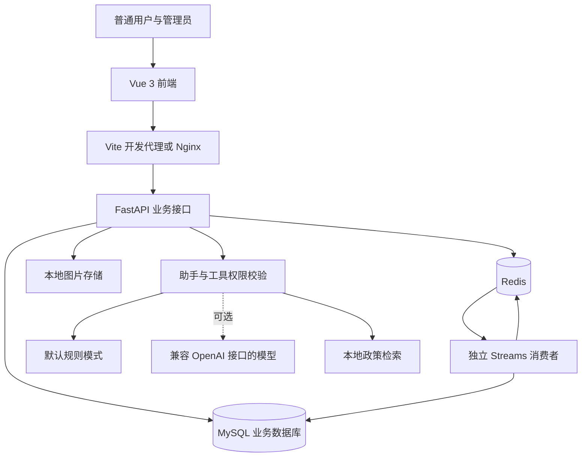
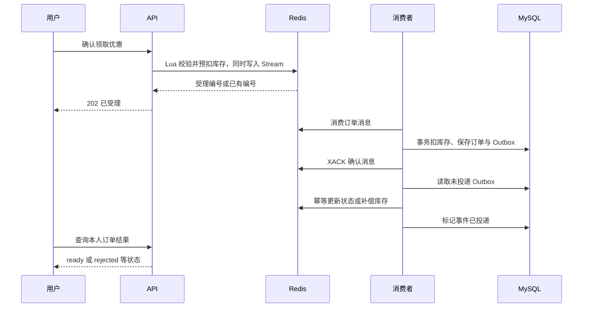
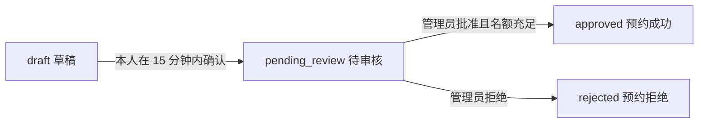
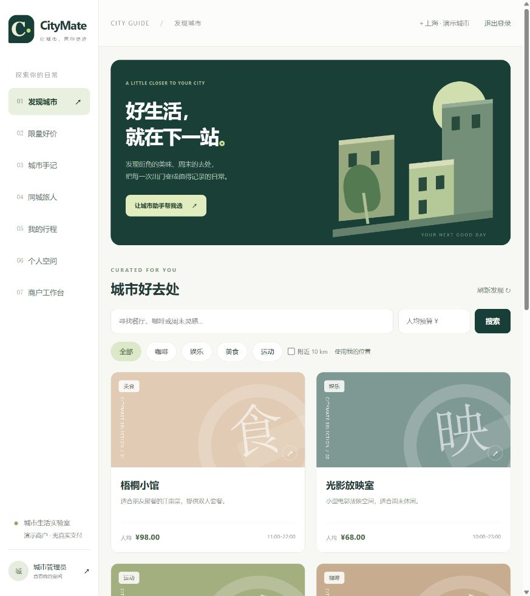
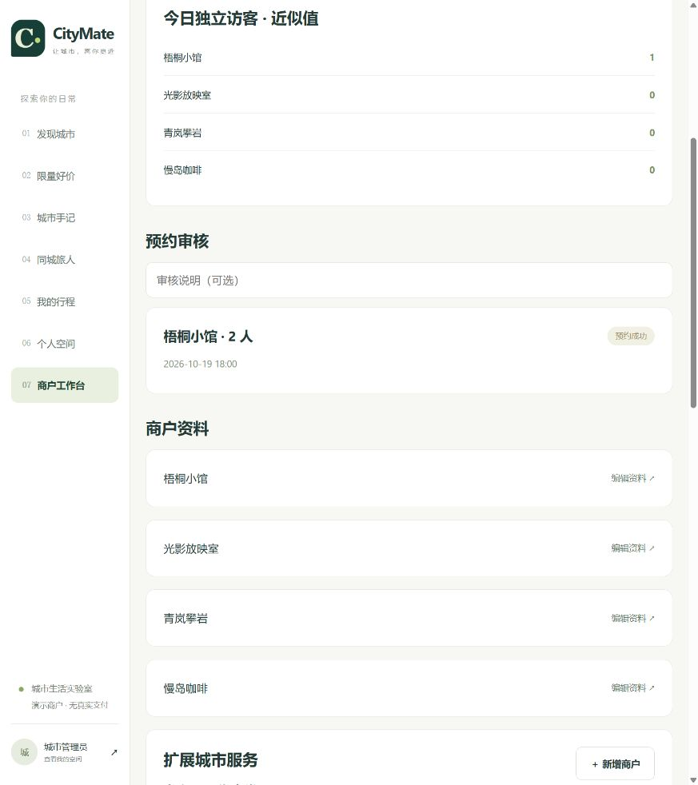

# CityMate 城市生活助手项目说明

源码核对日期：2026 年 10 月 20 日。

本文按当前仓库代码描述功能。默认启用的功能、需要配置的代码分支和实际测试记录分别说明；Chroma/MCP 已于 2026-10-21 完成隔离环境联调，仍为默认关闭的可选能力，不能据此宣称生产检索效果达标。分模块源码与测试依据见 [Redis 讲义](CityMate-Redis实战项目讲义.md) 开头的核对表。

CityMate 是由 CoursePilot 改造而来的 Python 本地生活平台。用户可以发现商户、查询附近去处、领取限量优惠、预约到店、发布探店手记、关注其他用户，以及签到获取积分。管理员负责商户与优惠管理、预约审核和运行状态查看；智能助手提供商户推荐、优惠解释、本人订单查询和预约草稿辅助。

项目将黑马点评中的 Redis 与后端工程实践放进同一个可操作的业务场景，采用 Python 实现对应能力。它适合学习、功能演示和项目讲解；当前商户、优惠和预约规则为演示数据，尚未对接真实短信、支付和商户核销。

## 1 项目定位与改造关系

原 CoursePilot 面向教育咨询与教务业务。改造后的 CityMate 将使用场景切换为城市生活服务，使附近查询、限量抢购、探店社区、关注动态和签到排行榜都有明确的业务用途。

| 维度 | CityMate 当前实现 |
|---|---|
| 产品场景 | 商户发现、优惠领取、到店预约、社区互动 |
| 前端 | Vue 3、Vite、自定义 CSS、markdown-it 回复渲染 |
| 后端 | Python、FastAPI、SQLAlchemy、Alembic |
| 数据服务 | MySQL 保存业务记录，Redis 承担会话、缓存、抢购和查询加速 |
| 智能助手 | 默认规则模式，可配置兼容 OpenAI 接口的模型 |
| 部署形态 | 一个业务 API、一个独立消费者，以及前端和数据服务 |

这是黑马点评核心业务与技术实践的 Python 场景化实现。Spring Boot、MyBatis-Plus、Redisson 等 Java 组件没有直接迁入；它们在本项目中的对应实现见第 5 节。项目没有引入微服务注册中心、Kafka 或 RabbitMQ，异步订单使用 Redis Streams。

当前仓库统一为 CityMate，旧教育版入口及配套代码已移出并归档。后端使用 `citymate.app:app`，前端使用 `src/App.vue`；部署、依赖和测试各有一套统一入口。仓库目录暂仍叫 `CoursePilot-GitHub`，工作区外层的历史目录不在本次整理范围内。详见 [代码结构与开发规范](代码结构与开发规范.md)。

## 2 用户角色与功能

### 2.1 普通用户

| 功能 | 操作与结果 |
|---|---|
| 登录与个人资料 | 手机号验证码登录、首次登录注册、修改昵称和简介、退出登录 |
| 商户发现 | 按类别、关键词、预算筛选，查看地址、营业时间和人均消费 |
| 附近商户 | 使用演示坐标或浏览器定位，根据距离查询商户 |
| 限量好价 | 查看活动时间和名额，主动确认领取，等待异步订单结果 |
| 我的订单 | 查询本人订单及处理状态，取消已生成的演示订单 |
| 到店预约 | 选择商户、时段与人数，创建草稿，确认后进入审核 |
| 探店社区 | 发布文字和图片、点赞或取消点赞、关注或取消关注、查看共同关注 |
| 关注动态 | 浏览关注作者的内容，通过游标继续加载 |
| 签到与排行 | 每日签到获得 10 积分，查看连续签到天数、月签到天数和积分榜 |
| 城市助手 | 询问推荐、优惠、订单和预约；回复渲染为 Markdown 排版，展示当前模式及工具轨迹 |

每个用户只能查询、取消自己的订单，确认自己的预约草稿。重复签到不会重复获得积分。

### 2.2 管理员

管理员可以创建和编辑商户、创建限量优惠、批准或拒绝预约，并查看消费者在线状态、待处理消息和商户近似独立访客数。管理员身份由演示初始化或服务器命令授予，普通注册接口不能自行指定管理员角色。

当前没有独立的商家入驻、商家结算和多商家权限系统，管理工作台由平台管理员使用。

### 2.3 演示数据

初始化包含上海地区的 4 家虚构商户：梧桐小馆、光影放映室、青岚攀岩、慢岛咖啡，覆盖美食、娱乐、运动和咖啡。每家商户初始配置一张限量体验券，库存为 10；初始化还会补充未来 7 天每日 18:00 的演示预约时段，初始每时段 12 个名额。

重复初始化不会重置已存在的优惠库存或已使用的预约名额。演示优惠首次创建后有效期约 30 天，重复初始化不会延长旧活动。其他城市的附近查询可能为空。

本机还已导入扩展模拟内容：当前共 20 家商户、20 个优惠和 25 篇手记，并新增 12 位带“·模拟”标记的作者、点赞、关注、签到榜单和预约审核样例。扩展数据使用独立的 `seed-rich` 命令追加，详情见 [开发指南中的扩展示例数据](CITYMATE.md#扩展示例数据)。个人订单与用户自己创建的预约保持原状。

## 3 系统架构



前端经 `/api` 访问后端，代理转发时去掉该前缀。例如页面请求 `/api/shops`，对应后端 `/shops`。图片由 `/uploads/` 提供。开发环境使用 Vite 代理，容器环境使用 Nginx。

MySQL 保存用户、商户、订单、预约、笔记和互动记录。Redis 同时承担业务加速和抢购受理，因此不能把所有 Redis 数据都当作可随意清空的缓存。独立消费者必须运行，才能持续完成异步订单与可靠事件投递。

## 4 技术栈及作用

| 技术 | 在本项目中的用途 |
|---|---|
| Python 3.12 | 业务服务和后台消费者运行环境 |
| FastAPI、Uvicorn | HTTP 接口、身份依赖、应用运行和自动接口文档 |
| Pydantic | 请求与工具参数校验，拒绝未声明字段 |
| SQLAlchemy、PyMySQL | 数据模型、查询、事务和 MySQL 连接 |
| Alembic | 新业务表的版本迁移与字符集修正 |
| Redis、redis-py | 登录会话、缓存、锁、库存、消息流和数据结构实践 |
| Lua | 一次性验证码校验、原子抢购受理、幂等库存补偿 |
| Vue 3、Vite | 页面交互、开发代理和静态资源构建 |
| Pillow | 上传图片内容校验、缩放与重新编码 |
| Prometheus Client | 请求数量与耗时指标，接口需要管理员权限 |
| pytest、fakeredis | 业务、权限、并发、重试与故障路径测试 |
| Docker Compose、Nginx | 数据服务与应用编排、前端托管和接口代理 |
| OpenAI SDK | 配置模型密钥后执行工具调用；有实际调用记录 |

基础 Python 依赖锁定在 `backend/requirements.txt`；测试依赖和可选 AI 依赖分别位于 `requirements-dev.txt`、`requirements-ai.txt`。

`requirements-ai.txt` 中另有 Chroma/MCP 可选依赖，已验证真实向量生成、持久化、MCP stdio 工具调用与模型聊天串联；中文检索样本首位命中为 3/6，默认配置保持本地词项检索。详见 [知识检索联调报告](知识检索联调报告.md)。

## 5 黑马点评技术点在新项目中的对应实现

| 技术点 | CityMate 的业务落点 | 核心实现 |
|---|---|---|
| Web 框架与 ORM | 所有业务接口和数据访问 | FastAPI、SQLAlchemy、Alembic |
| 验证码与登录态 | 手机号登录 | 验证码一次消费、频率限制、Cookie + 服务端 Session、续期 |
| 用户上下文 | 订单、预约、聊天身份 | 从 Session 获取用户，通过 request.state 和 Depends 传递，客户端不能覆盖用户 ID |
| 缓存穿透 | 不存在的商户详情 | 空值缓存，降低重复查库 |
| 热点缓存重建 | 商户详情 | 默认互斥重建，可选逻辑过期与后台刷新 |
| 写后缓存失效 | 管理员修改商户 | 数据库更新后删除详情缓存，并更新位置索引 |
| 分布式锁 | 缓存、关注、点赞和签到 | redis-py 带所有权令牌的锁；未实现 Redisson 自动看门狗 |
| 全局订单 ID | 异步抢购编号 | UTC 秒时间戳与 Redis 日序列组合，按字符串返回前端 |
| 防超卖与重复领取 | 限量体验券 | Lua 检查时间、库存和领取记录，SQL 条件扣库存与唯一约束兜底 |
| 消息队列 | 异步生成订单 | Redis Streams 消费组、XACK、pending 重试和 XAUTOCLAIM 接管 |
| 可靠事件与补偿 | 取消订单、拒单与社区投递 | SQL 事务内写 Outbox，消费者重试投递，Redis 幂等处理 |
| Sorted Set | 点赞顺序、关注动态、积分排行 | 有序成员、分数查询、时间分数与同分偏移游标 |
| Set | 关注与共同关注 | 关注集合及集合交集 |
| Bitmap | 每日签到 | 每月位图记录，结合 SQL 账本计算统计与跨月连续天数 |
| GEO | 附近商户 | GEOSEARCH 距离查询 |
| HyperLogLog | 商户每日 UV | 对登录访问用户做近似去重计数 |

这些实现展示了核心机制和恢复路径，尚无生产规模吞吐或高可用验证。不能把当前功能完成度直接表述为“百万并发”或“数据绝不丢失”。

## 6 核心业务流程

### 6.1 登录与鉴权

登录采用与 PPT 对应的 Cookie + 服务端 Session 流程，Python 后端使用 Redis 保存 Session。获取验证码时，校验手机号，创建匿名 Session，将手机号和验证码存入 Session（有效期 5 分钟），并通过 `Set-Cookie` 返回随机会话 ID。演示模式将验证码直接返回页面。

登录时浏览器自动携带 Cookie，后端从对应 Session 读取验证码，通过 Lua 校验手机号与验证码并一次性消费；按手机号查询用户，不存在则注册。成功后更换会话 ID，将用户信息存入新的 Session，并删除匿名 Session。登录响应不返回 Bearer Token，前端不在 localStorage 保存登录凭证。

后续请求自动携带 `citymate_session` Cookie。受保护接口通过 `Depends(current_user)` 校验 Session，将当前用户保存到 `request.state.user` 并注入接口参数；无有效登录态返回 401。这里的请求级状态对应 PPT 中 ThreadLocal 的用途，适合 Python 异步请求，不使用线程局部变量。

会话有效期为 30 分钟，鉴权成功会续期；退出登录会删除会话。用户角色从服务端读取，管理接口另做管理员校验。当前演示验证码直接返回页面；关闭演示模式后，由于短信供应商尚未配置，验证码签发会明确报错。

Cookie 使用 HttpOnly、SameSite=Lax 和 Path=/；浏览器 Cookie 为会话 Cookie，服务端控制 30 分钟的空闲过期时间。HTTPS 部署设置 `CITYMATE_COOKIE_SECURE=true`。前端通过同源 `/api` 代理访问后端，写请求必须带 `X-CityMate-Request: 1`，后端不开放跨域 CORS，以阻止跨站表单等伪造写请求。页面刷新通过 `/me` 恢复登录用户，退出登录同时清除 Cookie。

### 6.2 限量领取与异步订单



同一用户重复领取同一张尚未取消的优惠，会返回原受理编号，避免重复扣减。消费者即使重复收到消息，也会根据订单 ID 与购买约束避免重复成单。取消已生成订单后，数据库恢复库存并写入事件，Redis 通过幂等补偿恢复可领取名额；取消完成并释放领取记录后可再次领取。

| 状态 | 含义 |
|---|---|
| `processing` | Redis 已受理，等待后台处理；不是已付款或已成单 |
| `ready` | 演示订单已落库，可在订单页取消；没有真实支付 |
| `rejected` | 数据库最终校验未通过，通过事件补偿预扣 |
| `cancelled` | 订单已取消，库存恢复流程可重试且不重复补偿 |

消息处理采用至少一次投递与业务幂等。SQL 订单和 Outbox 在同一事务中提交，但 Redis 与 MySQL 之间没有跨系统原子事务。消费者崩溃后的 pending 接管、数据库提交后尚未确认消息、补偿事件重复执行等路径已有对应处理。

库存计数器缺失时，如果 SQL 已有该券订单，或 Redis 的领取关系/初始化标记仍存在，服务返回 503；三种证据都不存在时会按 SQL 库存初始化。若尚未落库的预扣与 Redis 证据一起丢失，这个检查无法发现此前受理，因此不能描述为 Redis 整体丢失后仍能安全恢复。

### 6.3 预约申请与审核



创建草稿时检查时段、人数与当前余量。待审核阶段不预占名额；批准时在数据库事务中按剩余名额进行条件扣减，因此两个待审核申请不能都凭同一份余量获得批准。草稿过期后需重新生成，批准时还会检查预约时间是否已过。

优惠订单和预约是独立业务：领取优惠券不会自动生成预约；预约批准也不代表完成付款。当前没有已批准预约自动改期或撤销后返还名额的完整流程。

### 6.4 社区、签到与查询加速

笔记、关注、点赞和签到记录保存在 MySQL。Redis 用于生成点赞顺序、共同关注、动态收件箱、签到位图和积分排行。发布笔记会在事务内写入 Outbox，由消费者向关注者的动态收件箱投递。

关注流保留最近 500 条，游标同时携带时间分数和同分偏移，处理同一毫秒出现多条内容的分页情况。当前没有海量粉丝分批投递或冷热用户混合推拉方案。

图片必须先经过上传接口；支持 JPEG、PNG、WebP，单张不超过 5 MB、2000 万像素。后端实际解码、缩放并重编码为 JPEG，笔记最多引用 6 张已上传图片。

## 7 AI 助手与知识检索

默认未配置模型密钥时，助手使用明确标注的规则模式，支持基础商户筛选、优惠和订单查询，不代表已经调用大模型。

配置模型后，同一个助手根据关键词选择推荐、预约、优惠或订单角色，并限制可调用工具。没有新意图关键词的后续消息沿用当前会话角色，明确的新话题可以切换；角色与消息同样按用户、会话隔离并保留 24 小时。这是应用内的角色路由与工具调用，不是四个独立部署的智能体服务。

关键业务回复由程序约束：模型成功调用预约草稿或本人订单工具后，后端直接根据结果输出草稿编号、时段、人数或订单状态说明，并终止本轮模型续写；订单工具未成功时，不采纳模型自行描述的订单状态。推荐角色识别到明确的附近、距离或定位请求时，直接说明对话助手不支持此能力，不调用模型。`response_kind` 区分模型回答、业务模板、能力提示、规则模式和确认结果；`mode=llm` 表示已配置模型，某一轮是否实际调用应看 `model_calls`。这不是通用事实核查，其他自由回答仍可能出现无依据内容，验证边界见 [Agent 专项评测报告](Agent专项评测报告.md)。

| 能力 | 当前边界 |
|---|---|
| 业务工具 | 查询商户、优惠、时段、本人订单与政策，生成预约草稿 |
| 用户身份 | 后端绑定当前会话用户，工具参数不能覆盖身份 |
| 写入动作 | 模型可创建草稿；提交需要用户点击确认或输入完整确认口令 |
| 交易操作 | 模型不能直接抢购、取消订单或审核预约 |
| 会话记忆 | 按用户与会话隔离，在 Redis 保存最近消息及明确预算、类别偏好，保留 24 小时 |
| 默认检索 | 读取版本化政策文件，进行轻量词项匹配 |
| 商户搜索工具 | 支持类别、关键词与预算；没有经纬度参数，距离排序由商户页面/API 提供 |

政策文件位于 `backend/citymate/policies/`。2026-10-22 起，两种检索方式共用段落级 Chunk：识别 Markdown 标题层级，以空行分隔段落，不跨段落或章节合并；连续非空行属于同一段。超过上限的段落优先在后半窗口的句末或空白处分割，否则按字符硬切，并保留重叠。当前 3 份政策只增加标题和段落组织，业务规则不变。

默认块长上限为 **320 个 Unicode 字符**，长段落相邻块重叠至多 **48 个字符**（去除首尾空白后可能更少），不是 Token 数。短段落保持完整，不为凑长度跨条款合并；不同段落不重叠。这是一套可配置的初始策略，不代表经过质量调优的最优参数。

每块返回 `source`、`title`、`section`、`document_id`、`document_version`（全文 SHA-256）、`chunk_index`、`chunk_id`、`start_char` 和 `end_char`。位置为换行归一化后原文的左闭右开字符区间，`content` 可由原文精确切片复原。模型工具结果及 `/chat` 的 `sources` 都保留这些字段，前端尚未增加点击跳转到具体条款的界面。

默认检索按查询相邻两字符片段在块正文、标题和章节中命中的数量排序，没有最低相关分数阈值；零命中时仍可能返回块。模型模式可调用该工具，规则模式不会自动调用政策检索。

Redis 仅保存用户文本和最终回复，不保存完整工具调用历史；前端刷新后不自动恢复旧会话，没有跨会话自动画像。2026 年 10 月 19 日曾使用临时 SQLite 与 fakeredis 验证真实模型调用、商户查询工具与本地政策检索；随后又记录了浏览器中的实际模型回复验证。

2026-10-21 补充 Agent 专项评测：固定 36 个场景、程序回归与真实模型调用分开统计，详细结果见 [Agent 专项评测报告](Agent专项评测报告.md)。助手增加当前上海日期时间提示；普通商户查询不强制索取位置；工具错误反复发生且耗尽轮次时返回可操作的失败说明。接口新增模型调用次数和服务商报告的 Token 用量；缺失用量明确标记，不视为零成本。

类别明确的普通推荐会在首次模型调用指定商户查询工具，距离类请求除外。取消订单的回答提示明确区分 processing 与 ready，助手本身仍不能取消订单。完整评测版本与后续针对性修正版本的结果分别保留，不能把子集复测作为全量通过。

**可选能力：** Chroma 分支使用新的 `citymate_policy_chunks_v1` 集合及默认 384 维 ONNX 嵌入，以块为向量记录；旧的 `citymate_policies_v1` 文档集合保留，但不再查询。应用启动时同步当前政策块，写入新块后清理新集合内已失效的块，涵盖文件更新、删除、置空及分块参数改变。该集合专用于一个政策目录；所有实例应使用同一份政策及参数，不应让不同政策快照同时写入。文件变更后需重启，没有热更新。

MCP 分支提供 stdio 政策连接，`knowledge_stats` 分别返回 `total_documents` 与 `total_chunks`，写入工具始终拒绝。Chroma/MCP 默认不启用。2026-10-21 的真实模型结果属于旧文档级索引；分块版本的组件测试与质量结果分别记录在 [联调报告](知识检索联调报告.md)，不能混用历史成绩。

### 7.1 助手界面与 Markdown 展示

桌面端助手显示在右侧，宽度至少 1550px 的大屏使用 420–560px 面板，高度随可视窗口调整；小屏切换为单列，回复与输入框字号为 14px。聊天内容独立滚动，输入区保留在面板底部。

`POST /chat` 仍返回文本。前端 [App.vue](../frontend/src/App.vue) 将助手消息交给 [MarkdownMessage.vue](../frontend/src/components/MarkdownMessage.vue)，组件调用 [renderMarkdown()](../frontend/src/lib/markdown.js) 将文本转成 HTML，再通过 Vue 的 `v-html` 显示。标题、加粗、列表、引用、表格、链接与代码块直接展示排版结果；宽表格和代码块可横向滚动，样式集中在 [styles.css](../frontend/src/styles.css)。用户发送的消息仍按纯文本显示。

模型输出属于不可信内容：解析器禁用原始 HTML 并保留危险 URL 校验，链接在新标签打开且带 `noopener noreferrer`；图片只显示转义后的替代文字，不自动加载远程资源。这里的 `v-html` 只接收解析后的结果，不直接接收模型原文。代码块仅展示文本，不执行代码；当前没有语法高亮或数学公式渲染。

展示优化适用于规则和模型两种模式。预约确认按钮、工具调用轨迹与服务端身份校验保留各自逻辑，Markdown 排版不会赋予回复执行业务操作的权限。

## 8 数据模型与代码入口

### 8.1 主要数据表

新业务表统一使用 `cm_` 前缀，金额以整数分存储。订单 ID 作为字符串传输，避免浏览器大整数精度损失。

| 表名 | 保存内容与主要约束 |
|---|---|
| `cm_users` | 用户、手机号、昵称、角色；手机号唯一 |
| `cm_shops` | 商户分类、介绍、经纬度、地址、人均和营业时间 |
| `cm_vouchers` | 优惠内容、价格、库存、活动起止时间及所属商户 |
| `cm_orders` | 用户优惠订单；订单 ID 唯一，有效购买键唯一 |
| `cm_notes` | 探店标题、正文、图片路径和可选关联商户 |
| `cm_likes` | 点赞关系；用户与笔记联合主键 |
| `cm_follows` | 关注关系；用户与目标用户联合主键 |
| `cm_checkins` | 每日签到与积分；用户与日期联合主键 |
| `cm_appointments` | 预约草稿、申请、审核结果和人数 |
| `cm_slots` | 商户预约时段与剩余名额；商户与时段联合主键 |
| `cm_outbox` | 与业务事务一并提交的待投递事件 |

### 8.2 代码目录

```text
CoursePilot-GitHub/
├── backend/
│   ├── citymate/
│   │   ├── app.py               应用工厂、生命周期和中间件
│   │   ├── schemas.py           HTTP 参数校验
│   │   ├── dependencies.py      请求级用户、管理员与服务依赖
│   │   ├── routers/             按业务分组的六类接口
│   │   ├── config.py            环境配置
│   │   ├── runtime.py           服务组装与数据连接
│   │   ├── models.py            SQL 数据模型
│   │   ├── service.py           登录、商户、缓存、GEO
│   │   ├── commerce.py          抢购、订单、Outbox、预约
│   │   ├── social.py            社区、关注、签到、榜单
│   │   ├── scripts.py           Lua 原子操作
│   │   ├── worker.py            独立消费者
│   │   ├── assistant.py         AI 与规则助手、工具权限、记忆
│   │   ├── knowledge.py         政策检索
│   │   ├── knowledge_client.py  MCP 客户端
│   │   ├── knowledge_server.py  MCP 政策服务
│   │   └── policies/            政策源文件
│   ├── tests/                  当前项目测试
│   ├── migrations/             数据库迁移
│   ├── requirements.txt        运行依赖
│   ├── requirements-dev.txt    测试与格式化依赖
│   └── requirements-ai.txt     可选检索依赖
├── frontend/src/
│   ├── main.js                 挂载入口
│   ├── App.vue                 页面与交互
│   ├── lib/http.js             HTTP、Cookie 与错误处理
│   ├── lib/markdown.js         Markdown 解析与安全显示规则
│   ├── components/MarkdownMessage.vue  助手回复渲染
│   └── styles.css              页面样式
├── docs/                       说明、讲义、规范和开发指南
├── docker-compose.yml          统一容器编排
├── compose.cached-infra.yml     本机缓存镜像覆盖配置
└── start.ps1                   Windows 本地启动/停止
```

### 8.3 主要 API

以下为后端原始路径；通过前端代理访问时加 `/api`。详细字段与响应结构以运行中的 [Swagger 接口文档](http://localhost:18000/docs) 为准。

| 接口 | 用途与权限 |
|---|---|
| `POST /auth/code`、`POST /auth/login` | 获取验证码与登录 |
| `POST /auth/logout`、`GET /me`、`PUT /me` | 退出、读取与修改本人资料 |
| `GET /categories`、`GET /shops` | 公开分类与商户列表 |
| `GET /shops/{shop_id}` | 登录后查询详情并记录访客 |
| `GET /shops/{shop_id}/slots`、`GET /vouchers` | 查询时段与优惠 |
| `POST /vouchers/{voucher_id}/claim` | 登录后领取，返回受理结果 |
| `GET /orders`、`GET /orders/{order_id}` | 本人订单列表和详情 |
| `POST /orders/{order_id}/cancel` | 取消本人已生成订单 |
| `POST /appointments/drafts`、`POST /appointments/{draft_id}/confirm` | 创建与确认本人预约 |
| `GET /appointments` | 本人预约记录 |
| `GET /notes`、`POST /notes`、`PUT /notes/{note_id}/like` | 登录后浏览、发布和点赞 |
| `GET /users`、`PUT /users/{target_id}/follow`、`GET /users/{target_id}/common` | 用户、关注与共同关注 |
| `GET /feed`、`POST /uploads` | 本人关注流与登录图片上传 |
| `GET /checkin`、`POST /checkin`、`GET /ranking` | 登录后签到统计、签到和排行 |
| `POST /chat` | 登录用户的助手会话 |
| `POST /admin/shops`、`PUT /admin/shops/{shop_id}`、`POST /admin/vouchers` | 管理员创建商户、编辑商户和创建优惠 |
| `GET /admin/appointments`、`POST /admin/appointments/{appointment_id}/review` | 管理员查看和审核预约 |
| `GET /admin/stats`、`GET /metrics` | 管理员运行状态与指标 |
| `GET /health` | 数据服务、消费者和助手模式状态 |

## 9 启动与配置

### 9.1 当前工作区的本机启动

当前工作区使用仓库上一级的 `.venv-citymate` Python 环境，以及 MySQL 5.7、Redis 7 缓存镜像进行兼容验证。以下命令均在 `CoursePilot-GitHub` 根目录执行；要求 Docker 已启动、Python 与前端依赖已安装、数据库已完成迁移和演示初始化。

```powershell
# 启动既有兼容验证数据服务
docker compose -p citymate-check -f docker-compose.yml -f compose.cached-infra.yml up -d mysql redis

# 启动 API、独立消费者和前端
powershell -NoProfile -ExecutionPolicy Bypass -File ./start.ps1
```

访问入口：

- 前端：<http://localhost:15173>
- 接口文档：<http://localhost:18000/docs>
- 健康检查：<http://localhost:18000/health>

演示管理员手机号为 `13900000000`，演示作者为 `13900000001`；其他符合格式的手机号首次登录自动注册普通用户。点击获取验证码后，验证码直接显示在登录框。

停止本地应用：

```powershell
powershell -NoProfile -ExecutionPolicy Bypass -File ./start.ps1 -Action stop
```

该命令只停止脚本记录的应用进程，保留数据库容器和数据。如果提示已有启动记录，先检查页面是否正在运行；确需重新启动时，先用上述停止命令，再启动。不要重复启动多个占用相同端口的实例。

### 9.2 新环境安装与容器方案

首次在新机器使用时，参考 [开发与验收指南](CITYMATE.md) 的本机开发步骤创建 Python 环境、安装依赖、执行 `alembic upgrade head`、初始化演示资料，并在前端目录执行 `npm ci`。

仓库也提供完整容器方案：

```powershell
docker compose -p citymate up -d --build
```

该配置使用 MySQL 8.4、Redis 7.4、Python 3.12，首次启动通过 `init` 服务执行迁移和演示初始化，再启动 API、消费者及 Nginx 前端。镜像拉取和构建需要网络。默认完整容器方案因先前镜像仓库连接失败，尚未完成端到端验证。

完整容器方案与本机方案使用相同宿主机端口，应选择一种运行。`citymate` 和 `citymate-check` 是不同的 Compose 项目名，对应不同数据卷；切换项目名不会自动迁移原数据，也不要把 MySQL 5.7 数据卷直接挂载给 MySQL 8.4。

### 9.3 关键配置

| 配置项 | 用途 |
|---|---|
| `CITYMATE_DATABASE_URL` | SQLAlchemy 数据库连接串 |
| `CITYMATE_REDIS_URL` | Redis 地址及数据库编号 |
| `CITYMATE_DEMO` | 是否开启演示验证码与演示初始化 |
| `CITYMATE_COOKIE_SECURE` | HTTPS 部署设为 true，仅通过 HTTPS 发送会话 Cookie；本地 HTTP 演示默认 false |
| `CITYMATE_UPLOADS` | 上传图片保存目录 |
| `CITYMATE_CACHE_MODE` | 默认 `mutex`，可设为 `logical` 启用逻辑过期 |
| `OPENAI_API_KEY`、`OPENAI_MODEL`、`OPENAI_BASE_URL` | 可选模型密钥、模型名和兼容接口地址 |
| `CITYMATE_KNOWLEDGE_MODE` | 默认 `lexical`，可选 `chroma` |
| `CITYMATE_KNOWLEDGE_TRANSPORT` | 默认 `local`，可选 `mcp` |
| `CITYMATE_KNOWLEDGE_CHUNK_SIZE` | 最大块长，默认 `320` 个字符，至少为 2 |
| `CITYMATE_KNOWLEDGE_CHUNK_OVERLAP` | 长段落块重叠，默认 `48` 个字符，需非负且小于块长 |
| `CITYMATE_CHROMA_PATH` | Chroma 本地持久化目录 |
| `CITYMATE_AI_EXTRAS` | Compose 构建时是否安装可选 AI 依赖 |

表中的 Chroma/MCP 开关是配置入口，实际验证证据见 [知识检索联调报告](知识检索联调报告.md)。逻辑过期缓存也有代码分支，但当前测试集未专项覆盖该模式。

`start.ps1` 专用于当前本地演示：它会设置本地 MySQL、Redis 和演示模式，并通过 `CITYMATE_MODEL_ENABLED=false` 默认关闭模型调用，即使本地文件保存了 Key 也保持规则模式。需要使用已配置的模型时加 `-EnableModel`。自定义数据库部署应使用手动启动方式或修改部署配置。

当前本地 `backend/.env` 已保存模型三项配置，服务地址为硅基流动兼容接口，2026-10-21 将模型切换为 `Qwen/Qwen3-32B`（通过云端 API 调用，没有在本机部署权重）。该文件被 Git 忽略，不在文档中公开 Key。启动时运行带 `-EnableModel` 的命令；修改模型后需要重启后端。先前 DeepSeek 的评测记录保留为历史结果，32B 的验证范围与结果见 [Agent 专项评测报告](Agent专项评测报告.md)。

容器配置可参考 `.env.example`，使用 `docker compose --env-file <配置文件> ...` 显式传入。仅复制示例文件而不指定加载方式，不等于配置已生效。Compose 已透传 `CITYMATE_CACHE_MODE`，默认为 `mutex`。

## 10 演示顺序与故障排查

### 10.1 推荐演示顺序

1. 普通账户登录，按类别和预算筛选商户，查看详情与附近商户。
2. 领取一张优惠券，观察受理提示，再到订单页看到生成结果。
3. 创建到店预约并确认，看到待审核；切换管理员批准，再回普通账户查看预约成功。
4. 发布探店手记，用第二个账户点赞、关注，查看关注流与共同关注。
5. 签到一次，再次点击验证不会重复加分，查看排行榜。
6. 向助手输入“预算 100 元，想吃饭”“查一下我的订单”，观察规则模式和当前用户数据。
7. 管理员修改商户，查看更新后的详情；打开工作台观察消费者心跳和访客统计。

### 10.2 常见问题

| 现象 | 检查方法 |
|---|---|
| 页面无法打开 | 检查前端是否启动、15173 端口是否被占用，以及 `web.err.log` |
| 接口提示数据服务不可用 | 检查 MySQL、Redis、连接配置和数据库迁移；读取 `api.err.log` |
| 订单一直处理中 | 检查独立消费者、健康检查中的 `worker_online`、工作台 pending 和 `worker.err.log` |
| 附近商户为空 | 确认定位与查询半径；当前商户只位于上海演示区域 |
| 没有可预约时段 | 演示时段有日期；在演示模式和相同连接配置下重新执行 `python -m citymate.cli seed` 可补充未来时段 |
| 优惠活动过期 | 管理员创建新活动；重复初始化不会延长旧优惠有效期 |
| 提示库存缓存缺失 | 暂停该活动，核对数据库订单、Stream 与预扣记录；不要清空 Redis 后盲目重置库存 |
| 助手标注规则演示 | 当前没有启用模型密钥；本机脚本还需要 `-EnableModel` |

本地脚本日志位于 `backend/logs/citymate/`。容器运行时可用 `docker compose -p citymate logs api worker web` 查看对应服务日志。

## 11 测试记录与当前边界

**2026-10-22 负载验证：** 新增真实 HTTP 的隔离压测入口，分别测量请求在途并发、受理吞吐、订单最终完成延迟、队列与 Outbox 积压，以及真实 32B 模型的多轮任务完成率。执行证据、有限测试规模和暴露的问题见 [压力测试与容量验证报告](压力测试与容量验证报告.md)。这与下方 TestClient 并发正确性验证采用不同口径。

**2026-10-20 新增验证：** 原有 31 项后端测试在模拟环境和真实 MySQL、Redis 上均通过；另新增 10 项真实服务并发与故障测试并全部通过，包括 25 人抢 10 个名额、重复领取/消费、并发取消、消费者独立进程在提交前后被强制结束后的接管恢复、事务回滚、补偿响应丢失重试与预约容量竞争。本次没有修改生产业务逻辑。复现步骤、环境隔离、结果和未覆盖边界见 [验证报告](并发与故障验证报告.md)。下方按日期保留早期阶段记录。

2026 年 10 月 19 日代码结构统一阶段，31 项后端测试、4 项前端 HTTP 客户端测试通过，前端生产构建、Black/Prettier 格式检查、Compose 配置与启动脚本语法检查通过。该阶段使用 SQLite + fakeredis，没有重跑真实数据库、浏览器全流程或外部模型/MCP 联调。

同日随后重启本机 API、Worker 和前端，确认 MySQL、Redis 健康，20 条商户正常加载；浏览器验证验证码登录、刷新后保持登录和“我的行程”页面。助手面板放大与 Markdown 展示优化后，前端共 7 项测试通过（4 项 HTTP、3 项 Markdown），生产构建与 Prettier 检查通过，并用实际模型回复验证标题、表格与加粗排版。这些检查没有覆盖完整订单流程、Chroma/MCP 全链路或生产并发；本次文档同步也未重新运行这些测试。

以下是 2026 年 10 月 18 日改造验收记录，并非本文更新时重新执行的结果：

| 验证项 | 已记录结果 |
|---|---|
| SQLite 与 fakeredis | 初始 17 项测试通过 |
| 真实 MySQL 5.7 与 Redis 7 | 最终 20 项集成测试通过 |
| 并发预扣 | 25 个用户争抢 10 个名额，接受 10 笔不同订单 |
| 幂等与恢复 | 覆盖重复消费、pending 接管、拒单补偿、重复取消 |
| 权限与业务 | 覆盖身份隔离、管理员权限、预约名额、模型工具越权拒绝等 |
| 前端 | 生产构建通过，5 项保留的旧版兼容模块测试通过 |
| 浏览器流程 | 登录、异步成单、签到、本人订单查询、预约提交和管理员批准已走通 |

后端测试从 `backend` 目录使用项目 Python 环境执行：`python -m pytest tests -q`。默认使用 SQLite 与 fakeredis；真实服务测试需要单独的 `citymate_test` 数据库，以及 `CITYMATE_TEST_DATABASE_URL`、`CITYMATE_TEST_REDIS_URL`。测试会清空该测试库中的新平台表，不能指向业务数据库。

前端在 `frontend` 目录执行 `npm run build`、`npm test` 和 `npm run format:check`。当前 Node 测试覆盖统一 HTTP 客户端，以及 Markdown 排版、HTML 转义、危险链接过滤和远程图片不加载，不代表页面已经具有完整自动化端到端测试覆盖。

当前交付范围不包含真实短信、支付、退款、核销、已批准预约改期、独立商家后台、生产级高可用和灾难恢复。Redis 已启用 AOF 持久化配置，SQL 与 Outbox 支持处理重试，但没有证明 Redis 整体数据丢失等灾难场景下零丢单。数据量增长后还需补充消息与事件清理、容量评估和压测。

## 12 页面与进一步阅读

首页截图来自 2026 年 10 月 18 日的演示版本，实际库存、日期和用户状态以运行页面为准。





- [开发与验收指南](CITYMATE.md)：环境准备、可选 AI 配置、测试与一致性边界。
- [项目首页说明](../README.md)：快速入口与主要代码文件。
- [代码结构与开发规范](代码结构与开发规范.md)：统一目录、职责、格式与旧路径对照。
